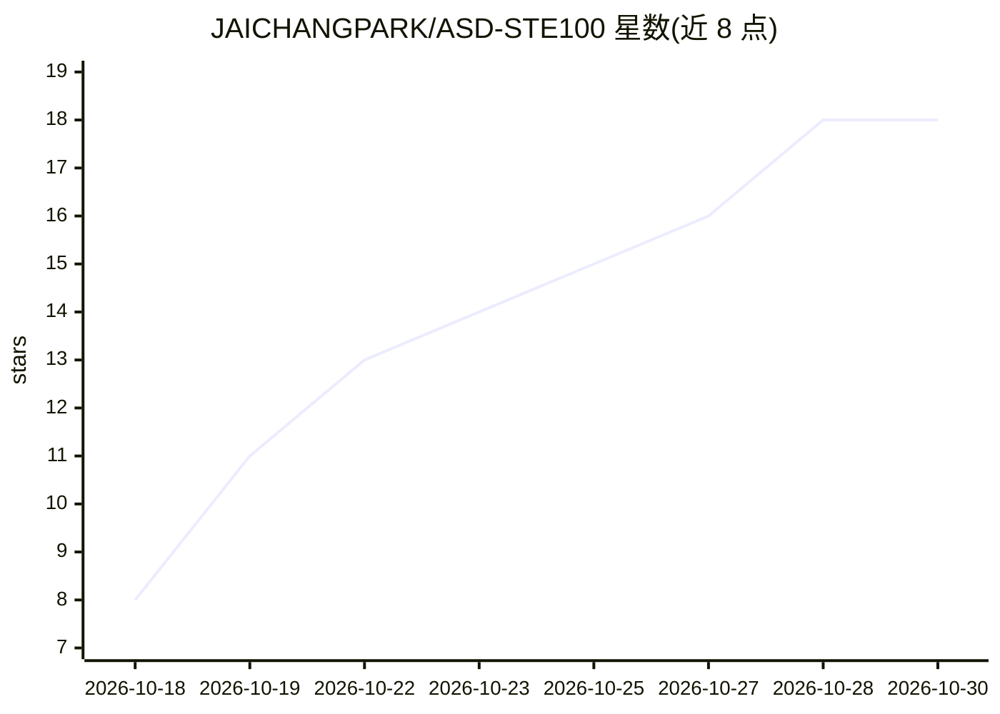

# JAICHANGPARK/ASD-STE100

⭐ 18 · JavaScript · MIT · 推送 2026-10-02 · [GitHub](https://github.com/JAICHANGPARK/ASD-STE100) · [官网](https://github.com/JAICHANGPARK/ASD-STE100#readme) · 个人维护

**给 Claude Code 用户的 ASD-STE100 受控英语插件、技能与 CLI**

将 ASD-STE100（简化技术英语，Issue 9）打包为 Claude Code 生态工具：插件形式提供 /asd 命令、系统提示注入与 STE 面板（小模型将回答改写为维护手册样式的 STE 文档，含检查评分）、可被 Claude Code 与 Google Antigravity 加载的 Agent 技能，以及独立 CLI 和基于轻量启发式规则（非官方词典）的 linter，检查句长、被动语态、未批准词等。提供 Karpathy 80% 务实模式与 100% 严格模式两种强度。插件需 Claude Code v2.1.287 及以上。

## 筛选速览

| 维度 | 判定 | 备注 |
|---|---|---|
| AI 角色 | `ai-ecosystem` | LLM/agent 周边工具 |
| 许可风险 | `permissive` | MIT |
| 部署形态 | `None` |  |
| 模型依赖 | — | README 未给出锁定关系 |
| 硬件要求 | — | 无带数字的原话,不猜 |
| 安装摩擦 | `low` | 无编译、无系统依赖或容器化 |
| 成熟度 | — | 结构信号不足 |

## 能力要点

- Claude Code 插件/mod/Agent 技能/独立 CLI 四种形态
- STE 面板用小模型将回答改写为 ASD-STE100 文档并给出检查评分
- 规则引擎检查句长、被动语态、未批准词、短语动词等（轻量启发式，非官方词典）
- 严格模式与 Karpathy 80% 务实模式可切换

## 适用场景

- 让 Claude Code 的回答自动改写为受控技术英语以降低审阅负担
- 在终端用 CLI 检查或改写技术文本
- 为 Claude/Antigravity 等 agent 加载 ASD-STE100 技能

## 场景标签

`提示工程` `AI 写作` · 领域:Agent 开发

## 证据(README 行号)

> L3: > **Claude Code Plugin · Mod · Agent Skill · Linter & CLI**
> L23: This repository packages **ASD-STE100** into a complete ecosystem:
> L27: 4. **Core Rule Engine & Linter (`lib/ste-engine.js`)**: Checks sentence and paragraph length, passive voice (with t

## 星数曲线

2026-10-18 8 → 2026-10-30 18（+10）

---
*卡片 v1 · prompt 1.4 · 生成 2026-10-29 · 置信度 high · 依据 README sha `7029ee6428d4` · [字段定义](../../DATASET.md)*
