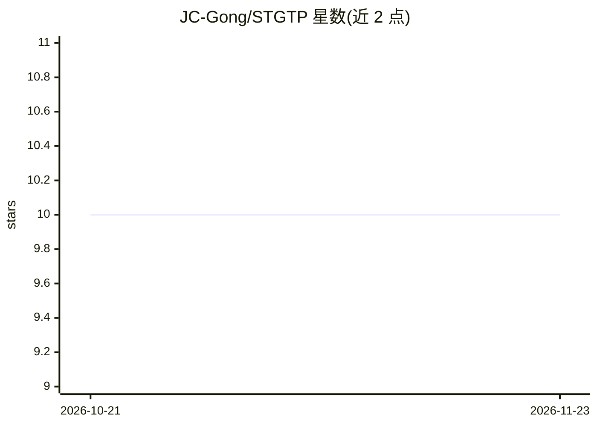

# JC-Gong/STGTP

⭐ 10 · Python · 推送 2025-12-03 · [GitHub](https://github.com/JC-Gong/STGTP) · [官网](https://doi.org/10.1016/j.tre.2025.104315) · 个人维护

**研究人员复现论文的船舶轨迹预测模型代码**

论文《Uncertainty-aware ship trajectory prediction via Spatio-Temporal Graph Transformer》的配套代码仓库，提供基于时空图 Transformer 的船舶轨迹预测模型 STGTP 的训练与验证脚本。用户需自行准备 AIS 格式（Time/MMSI/经纬度）数据集并放入指定目录结构后，通过 trainval.py 训练。代码大量借用 STAR 代码库，README 未包含模型介绍或评估结果。

## 筛选速览

| 维度 | 判定 | 备注 |
|---|---|---|
| AI 角色 | `ai-native` | 本体是模型或模型工具 |
| 许可风险 | `none` | — |
| 部署形态 | `library` | 以包/库形式分发 |
| 模型依赖 | — | README 未给出锁定关系 |
| 硬件要求 | — | 无带数字的原话,不猜 |
| 安装摩擦 | `low` | 无编译、无系统依赖或容器化 |
| 成熟度 | — | 结构信号不足 |

## 能力要点

- 提供 STGTP 模型的训练与验证脚本（trainval.py）
- 支持用户自备数据集，指定 Time/MMSI/经纬度格式
- 官方论文配套代码，附 BibTeX 引用信息

## 适用场景

- 复现论文中的船舶轨迹预测实验
- 在自己的 AIS 航迹数据上训练 STGTP 模型
- 参考时空图 Transformer 在轨迹预测中的实现

## 场景标签

`科研工具` · 领域:学习与行业

## 证据(README 行号)

> L3: Code for Uncertainty-aware ship trajectory prediction via Spatio-Temporal Graph Transformer
> L9: python trainval.py --dataset <your dataset> --model STGTP

## 星数曲线

2026-10-21 10 → 2026-11-23 10（+0）

---
*卡片 v1 · prompt 1.4 · 生成 2026-11-20 · 置信度 high · 依据 README sha `ed982588d54d` · [字段定义](../../DATASET.md)*
