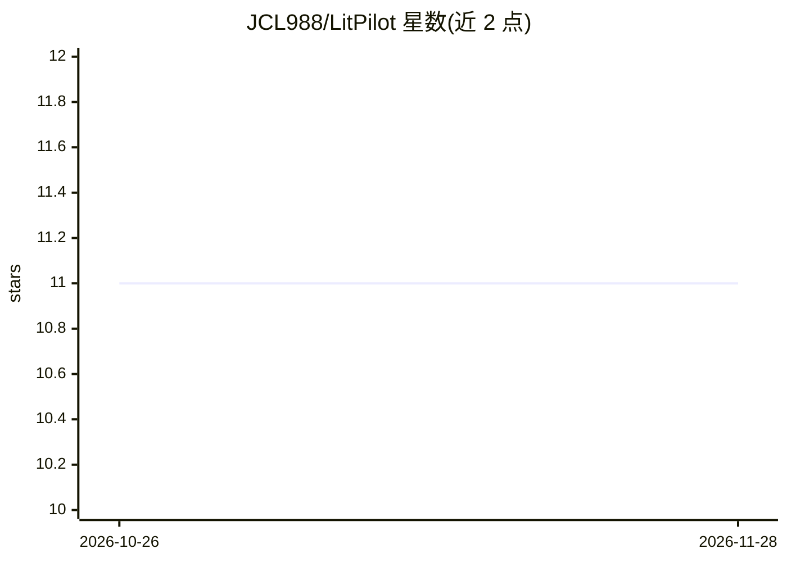

# JCL988/LitPilot

⭐ 11 · Python · MIT · 推送 2026-03-18 · [GitHub](https://github.com/JCL988/LitPilot) · 个人维护

**面向 PhD 学者的 LLM 文献综述处理流水线**

将 PDF/Word 文档自动抽取文本（扫描件走 OCR 回退），用可定制的结构化 agent prompt（BMAD 方法）将每篇论文的发现映射到用户自定义的综述结构，输出 markdown 结构化笔记、Excel 追踪表与跨论文综合报告。每条关键发现绑定页码、原文引用或转述，并标注作者陈述/模型推断与不确定性标记。不进行论文检索，不生成成文综述，输出质量依赖用户对 prompt 的定制程度，API 调用按篇计费。

## 筛选速览

| 维度 | 判定 | 备注 |
|---|---|---|
| AI 角色 | `ai-native` | 本体是模型或模型工具 |
| 许可风险 | `permissive` | MIT |
| 部署形态 | `library` | 以包/库形式分发 |
| 模型依赖 | locked-api |  |
| 硬件要求 | — | 无带数字的原话,不猜 |
| 安装摩擦 | `low` | 无编译、无系统依赖或容器化 |
| 成熟度 | — | 结构信号不足 |

## 能力要点

- 每条发现绑定页码并区分 [PAPER STATES] / [MODEL INFERS] 与不确定性标记
- Excel 追踪表记录方法论、相关性评级、章节映射、理论框架与 DOI
- 增量综合：可按月添加论文而无需重新处理全部
- --dry-run 模式在不调用 API 的情况下估算成本

## 适用场景

- 把一批已下载的 PDF 批量处理成对应自己论文结构的笔记
- 跨多篇文献找出覆盖缺口、主题聚类与矛盾点
- 在写作综述前筛选哪些论文值得精读

## 场景标签

`科研工具` `文档解析` · 领域:知识与检索

## 证据(README 行号)

> L3: Automate your PhD literature review using structured LLM agent prompts. Drop PDFs in a folder, get structured markdo
> L8: 2. **Analyses each paper** using a customisable LLM agent prompt that maps findings to your specific literature revi

## 星数曲线

2026-10-26 11 → 2026-11-28 11（+0）

---
*卡片 v1 · prompt 1.4 · 生成 2026-11-19 · 置信度 high · 依据 README sha `d59cfdab8b12` · [字段定义](../../DATASET.md)*
