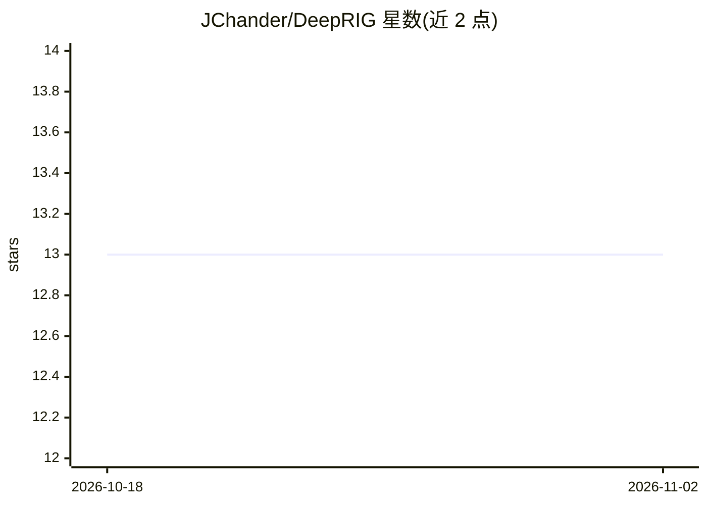

# JChander/DeepRIG

⭐ 13 · Jupyter Notebook · Apache-2.0 · 推送 2026-09-03 · [GitHub](https://github.com/JChander/DeepRIG) · 组织维护

**从 scRNA-seq 数据推断基因调控网络的深度学习模型**

基于图自编码器（GAE）的基因调控网络（GRN）推断方法：将单细胞基因表达矩阵转换为基于相关性的共表达网络，再用 GCN 编码-解码结构学习非线性基因调控关系，输出按边权重排序的调控关联，并提供 evaluate.py 评估脚本与交叉验证选项。支持细胞类型特异性 GRN 推断（Jupyter Notebook 教程）。依赖 Python 3.7 与 TensorFlow 2.4，可通过 conda 或 venv 安装，GPU 运行需 CUDA 11.0 与 cuDNN 8.0；附带 hESC/mESC/mDC 等 7 个演示数据集。

## 筛选速览

| 维度 | 判定 | 备注 |
|---|---|---|
| AI 角色 | `ai-native` | 本体是模型或模型工具 |
| 许可风险 | `permissive` | Apache-2.0 |
| 部署形态 | `library` | 以包/库形式分发 |
| 模型依赖 | — | README 未给出锁定关系 |
| 硬件要求 | — | 无带数字的原话,不猜 |
| 安装摩擦 | `medium` | 含编译或系统依赖之一 |
| 成熟度 | — | 结构信号不足 |

## 能力要点

- 表达矩阵→相关性共表达网络→GAE 解耦非线性调控关系
- main.py 支持交叉验证、负正样本比、隐层维度等参数配置
- evaluate.py 对推断结果与 ground truth 网络进行评估
- 支持细胞类型特异性 GRN 推断并提供 Notebook 教程

## 适用场景

- 从单细胞转录组数据推断基因调控关系
- 构建特定细胞类型的基因调控网络
- 用自带干细胞/免疫细胞数据集复现推断与评估流程

## 场景标签

 · 领域:生物信息学/单细胞分析

## 证据(README 行号)

> L2: A deep learning-based model for gene regulatary networks (GRNs) inferrence from scRNA-seq data that transforms gene 
> L62: To infer gene regulatary networks from scRNA-seq data using `main.py` script with the following options:

## 星数曲线

2026-10-18 13 → 2026-11-02 13（+0）

---
*卡片 v1 · prompt 1.4 · 生成 2026-10-31 · 置信度 mid · 依据 README sha `7042771aa1a1` · [字段定义](../../DATASET.md)*
