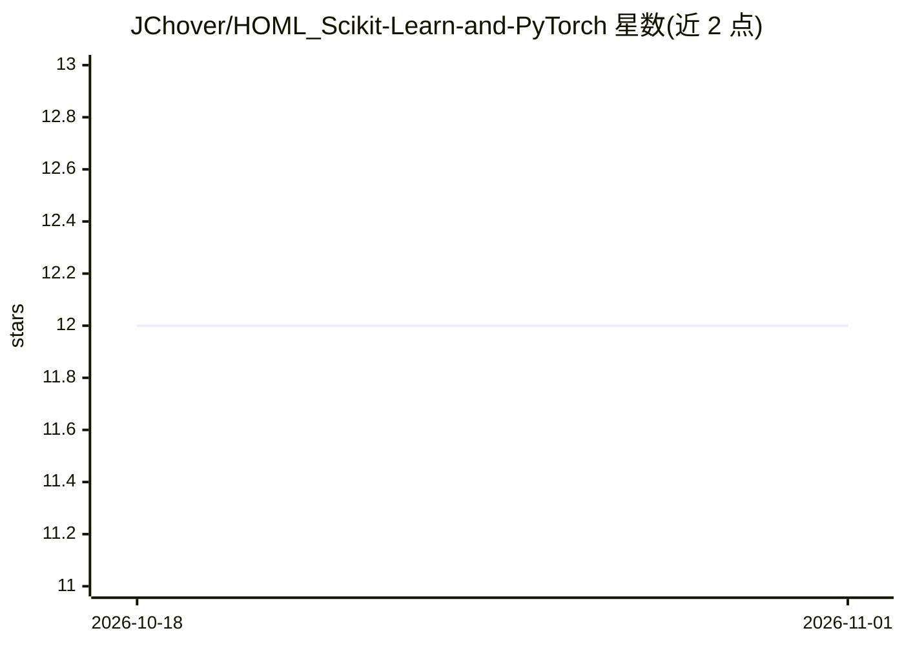

# JChover/HOML_Scikit-Learn-and-PyTorch

⭐ 12 · Jupyter Notebook · 推送 2026-06-20 · [GitHub](https://github.com/JChover/HOML_Scikit-Learn-and-PyTorch) · 个人维护

**《Hands-On Machine Learning》学习笔记与习题解答仓库**

个人学习仓库：记录阅读 Aurélien Geron《Hands-On Machine Learning with Scikit-Learn and PyTorch》过程中的习题解答与概念笔记。README 声明不收录书中内容，仅存放自己的解答。目录按书的 16 章组织，覆盖机器学习基础（回归、分类、决策树、集成学习、降维、聚类）与深度学习（PyTorch 神经网络、CNN、RNN、Transformer、视觉与多模态）。以进度清单勾选方式跟踪学习状态，阅读始于 2026-06-20。

## 筛选速览

| 维度 | 判定 | 备注 |
|---|---|---|
| AI 角色 | `ai-knowledge` | 知识聚合/清单类 |
| 许可风险 | `none` | — |
| 部署形态 | `None` |  |
| 模型依赖 | — | README 未给出锁定关系 |
| 硬件要求 | — | 无带数字的原话,不猜 |
| 安装摩擦 | `low` | 无编译、无系统依赖或容器化 |
| 成熟度 | — | 结构信号不足 |

## 能力要点

- 按书的 16 章组织学习进度清单（勾选式跟踪）
- Part I 覆盖 Scikit-Learn 机器学习基础，Part II 覆盖 PyTorch 深度学习
- README 明确声明不收录书中内容，仅存放个人习题解答

## 适用场景

- 跟随同书学习时参考他人习题解答思路
- 了解该书各章的知识点结构

## 场景标签

`教程课程` · 领域:学习与行业

## 证据(README 行号)

> L11: Here I will keep track of all the exercises and contents learned while reading the book "*Hands-On Machine Learning
> L13: > No content of the book will be available here, this repository is just a place where I will leave my solutions of
> L15: ## Progress

## 星数曲线

2026-10-18 12 → 2026-11-01 12（+0）

---
*卡片 v1 · prompt 1.4 · 生成 2026-11-01 · 置信度 high · 依据 README sha `3854113ec9e1` · [字段定义](../../DATASET.md)*
