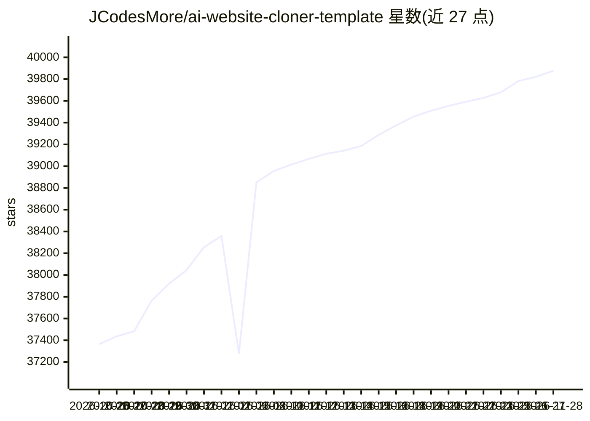

# JCodesMore/ai-website-cloner-template

⭐ 39,877 · TypeScript · MIT · 推送 2026-11-27 · [GitHub](https://github.com/JCodesMore/ai-website-cloner-template) · [官网](https://clonetheweb.com) · 组织维护

**AI 编码代理一条命令重建任意网站为 Next.js 应用的模板**

一个 Next.js 16 模板仓库，内置 /clone-website Agent Skill：用户提供 URL，AI 编码代理按四步流程（映射路由、观察提取资产与字体、构建可编辑组件、对比修复差异）将目标网站重建为干净的 Next.js 应用。支持 Claude Code（推荐）、Codex、Cursor、OpenCode。要求 Node.js 24+ 和具有浏览器访问能力的代理；产出包含路由映射、运行说明、对比截图与遗留差异清单。禁止用于钓鱼、冒充或侵权用途。

## 筛选速览

| 维度 | 判定 | 备注 |
|---|---|---|
| AI 角色 | `ai-native` | 本体是模型或模型工具 |
| 许可风险 | `permissive` | MIT |
| 部署形态 | `self-host` | docker 或自建部署 |
| 模型依赖 | — | README 未给出锁定关系 |
| 硬件要求 | — | 无带数字的原话,不猜 |
| 安装摩擦 | `low` | 无编译、无系统依赖或容器化 |
| 成熟度 | — | 结构信号不足 |

## 动量与使用信号

- 维护:`active` — 距上次 push 13.0 天,年发版 10,13 位贡献者
- 涨星:近 1 天 **+76**(自 20261016 起算)

## 能力要点

- /clone-website 技能按 Map/Observe/Build/Compare 四步重建网站
- 可移植 Agent Skill 放置于 .agents/skills/，多代理直接读取
- 对 Framer 页面和动画站点有专门的响应式与动效检查指引
- 提供 dev/build/lint/typecheck/check 脚本与 docker compose 运行方式

## 适用场景

- 把 WordPress/Webflow/Squarespace 站点迁移为 Next.js 代码库
- 源码丢失但站点仍在线时找回现代化代码
- 通过真实生产站点代码学习布局、动画与响应式实现

## 场景标签

`编码 Agent` · 领域:编码与开发

## 证据(README 行号)

> L5: Give your AI coding agent a URL and watch it recreate the website as a clean Next.js app.

## 星数曲线

2026-10-26 37,364 → 2026-11-28 39,877（+2,513）

---
*卡片 v1 · prompt 1.4 · 生成 2026-11-26 · 置信度 high · 依据 README sha `8a0e4a266e91` · [字段定义](../../DATASET.md)*
