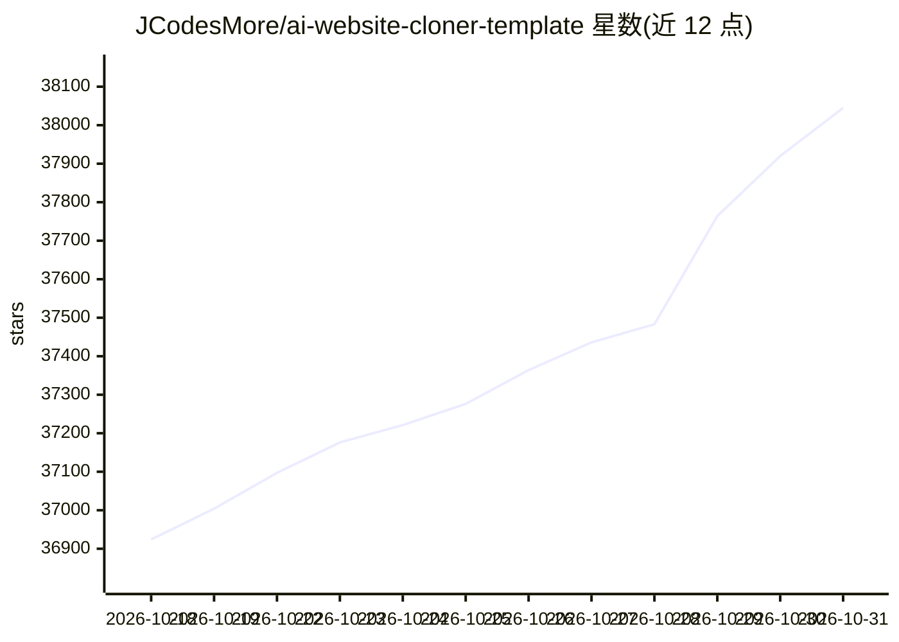

# JCodesMore/ai-website-cloner-template

⭐ 38,045 · TypeScript · MIT · 推送 2026-10-19 · [GitHub](https://github.com/JCodesMore/ai-website-cloner-template) · [官网](https://dsc.gg/jcodesmore) · 组织维护

**给 AI 编码代理的模板：一条命令把网站复刻为 Next.js 应用**

一个 Next.js 模板项目，核心是一个可移植的 Agent Skill（/clone-website）：用户给 AI 编码代理一个 URL，代理按 Map→Observe→Build→Compare 四步将目标网站复刻为可编辑的 Next.js 应用，产出路由映射、运行说明与对比截图。要求 Node.js 24+ 与具备浏览器访问能力的 AI 编码代理；Framer 页面与动效站点有专门的检查指引。README 明确声明不用于钓鱼、冒充或违反目标站点服务条款的场景。

## 筛选速览

| 维度 | 判定 | 备注 |
|---|---|---|
| AI 角色 | `ai-enhanced` | 去掉 AI 部分产品仍成立 |
| 许可风险 | `permissive` | MIT |
| 部署形态 | `self-host` | docker 或自建部署 |
| 模型依赖 | — | README 未给出锁定关系 |
| 硬件要求 | — | 无带数字的原话,不猜 |
| 安装摩擦 | `low` | 无编译、无系统依赖或容器化 |
| 成熟度 | — | 结构信号不足 |

## 动量与使用信号

- 维护:`active` — 距上次 push 13.0 天,年发版 10,13 位贡献者
- 涨星:近 1 天 **+76**(自 20261016 起算)

## 能力要点

- /clone-website 技能按四步流程复刻网站为 Next.js 应用
- 同一技能文件供 Codex、Cursor、OpenCode 直接读取，Claude Code 经命令桥接使用
- 复刻产出含路由映射、运行说明、对比截图与差距清单
- 对 Framer 页面与动效站点提供专门检查指引

## 适用场景

- 把自有的 WordPress/Webflow/Squarespace 站点迁移到 Next.js 代码库
- 源码丢失但站点仍在线时找回可用的现代格式代码
- 通过真实站点代码学习其布局、动画与响应式实现

## 场景标签

`网页抓取` `代码生成` · 领域:效率与自动化

## 证据(README 行号)

> L5: Give your AI coding agent a URL and watch it recreate the website as a clean Next.js app.
> L57: |Claude Code|**Recommended** — Opus 5.5|
> L125: The project keeps one portable Agent Skill at `.agents/skills/clone-website/`. Codex, Cursor, and OpenCode read it

## 星数曲线

2026-10-18 36,924 → 2026-10-31 38,045（+1,121）

---
*卡片 v1 · prompt 1.4 · 生成 2026-10-18 · 置信度 high · 依据 README sha `e37c2d12ba2a` · [字段定义](../../DATASET.md)*
