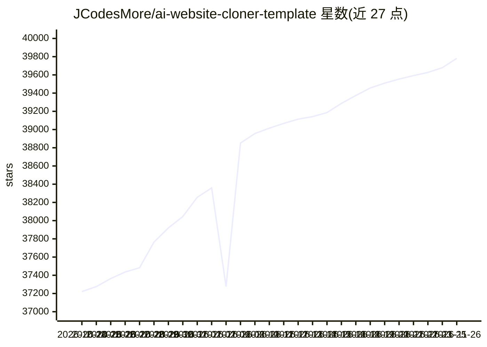

# JCodesMore/ai-website-cloner-template

⭐ 39,782 · TypeScript · MIT · 推送 2026-11-25 · [GitHub](https://github.com/JCodesMore/ai-website-cloner-template) · [官网](https://dsc.gg/jcodesmore) · 个人维护

**开发者用一条命令让 AI agent 复刻任意网站为 Next.js 应用**

一个 Next.js 16 模板项目，内置可移植的 Agent Skill（/clone-website），供 Claude Code、Codex、Cursor、OpenCode 等 AI 编码代理读取执行。按 Map/Observe/Build/Compare 四步流程：映射源站路由到本地路由、提取真实资产与字体、生成可编辑组件与交互、对比源站与本地页面修复差异并运行生产检查。依赖 Node.js 24+，README 声明结果以 Claude Code 搭配 Opus 5.5 最佳，并明确禁止用于钓鱼、冒充等用途。

## 筛选速览

| 维度 | 判定 | 备注 |
|---|---|---|
| AI 角色 | `ai-native` | 本体是模型或模型工具 |
| 许可风险 | `permissive` | MIT |
| 部署形态 | `self-host` | docker 或自建部署 |
| 模型依赖 | — | README 未给出锁定关系 |
| 硬件要求 | — | 无带数字的原话,不猜 |
| 安装摩擦 | `low` | 无编译、无系统依赖或容器化 |
| 成熟度 | — | 结构信号不足 |

## 动量与使用信号

- 维护:`active` — 距上次 push 13.0 天,年发版 10,13 位贡献者
- 涨星:近 1 天 **+76**(自 20261016 起算)

## 能力要点

- /clone-website 技能按 Map→Observe→Build→Compare 四步复刻网站
- 通过 .agents/skills/ 可移植技能支持 Codex、Cursor、OpenCode，Claude Code 经命令桥接入
- 输出路由映射、运行说明、对比截图与剩余差异清单
- 针对 Framer 页面与动画站点提供响应式变体与滚动/时间驱动动效的检查指引

## 适用场景

- 把 WordPress/Webflow/Squarespace 自有站点迁移到 Next.js
- 源码丢失但站点仍在线时重建现代化代码库
- 通过真实生产站点代码学习布局、动画与响应式实现

## 场景标签

`编码 Agent` `代码生成` · 领域:编码与开发

## 证据(README 行号)

> L5: Give your AI coding agent a URL and watch it recreate the website as a clean Next.js app.
> L82: The `/clone-website` skill follows four steps:
> L131: The project keeps one portable Agent Skill at `.agents/skills/clone-website/`. Codex, Cursor, and OpenCode read it

## 星数曲线

2026-10-24 37,221 → 2026-11-26 39,782（+2,561）

---
*卡片 v1 · prompt 1.4 · 生成 2026-11-22 · 置信度 high · 依据 README sha `3fd90a6913d6` · [字段定义](../../DATASET.md)*
