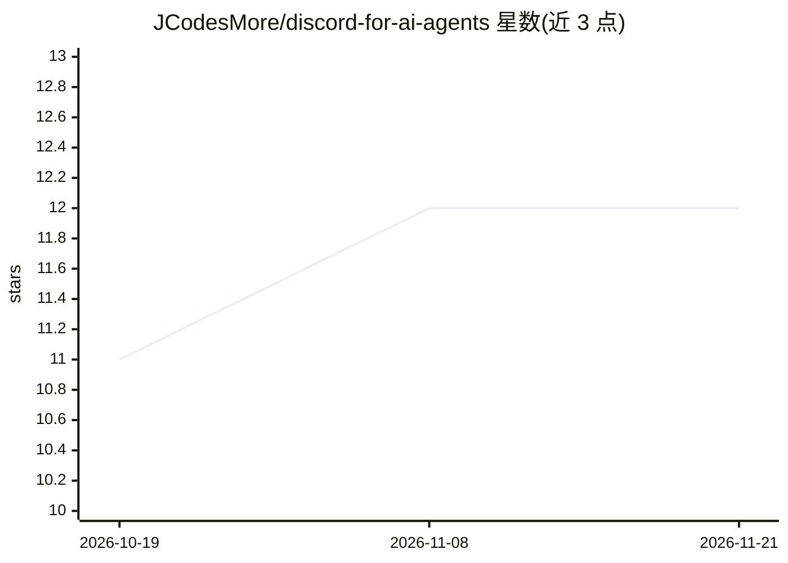

# JCodesMore/discord-for-ai-agents

⭐ 12 · TypeScript · Apache-2.0 · 推送 2026-05-07 · [GitHub](https://github.com/JCodesMore/discord-for-ai-agents) · [官网](https://dsc.gg/jcodesmore) · 个人维护

**让 Claude Code 通过对话管理 Discord 服务器的插件**

面向 Claude Code 用户的 Discord 管理 MCP 插件：通过 /plugin marketplace 安装后，内置 51 个 Discord 工具、2 个 skill 和 1 个 agent，覆盖频道、角色、消息、嵌入内容、AutoMod 规则、引导流程、欢迎屏幕、定时活动、成员、webhook 与服务器模板。用户以 /discord 命令入口用自然语言下达指令，agent 选择 Discord 原语调用、校验输入并报告变更结果；另提供 /discord:setup 一次性配置向导，在聊天中完成建 bot、贴 token、邀请入服等流程。附 4 个预设服务器模板，可用 JSON spec 自定义。

## 筛选速览

| 维度 | 判定 | 备注 |
|---|---|---|
| AI 角色 | `ai-native` | 本体是模型或模型工具 |
| 许可风险 | `permissive` | Apache-2.0 |
| 部署形态 | `None` |  |
| 模型依赖 | — | README 未给出锁定关系 |
| 硬件要求 | — | 无带数字的原话,不猜 |
| 安装摩擦 | `low` | 无编译、无系统依赖或容器化 |
| 成熟度 | — | 结构信号不足 |

## 能力要点

- 51 个 Discord 工具封装为 2 个 skill 和 1 个 agent
- 全部操作经 /discord 入口以自然语言驱动，agent 自动选择调用原语
- 内含 /discord:setup 一次性配置向导（建 bot、贴 token、邀请、选 guild）
- 4 个捆绑服务器模板，支持 JSON spec 组合或由 architect agent 起草

## 适用场景

- 用一句话从零搭建一个完整社区的 Discord 服务器
- 为开发社区应用现成服务器模板并配置 AutoMod 规则
- 通过对话管理频道、角色、公告嵌入和定时活动

## 场景标签

 · 领域:开发工具/社区管理

## 证据(README 行号)

> L3: ### Run your Discord server by talking to Claude.
> L19: **1. Install the plugin** — inside Claude Code, run:
> L55: **51 Discord tools** wrapped in **two skills** and **one agent** — covering channels, roles, messages, embeds, Auto

## 星数曲线

2026-10-19 11 → 2026-11-21 12（+1）

---
*卡片 v1 · prompt 1.4 · 生成 2026-11-18 · 置信度 high · 依据 README sha `69f075857fd1` · [字段定义](../../DATASET.md)*
