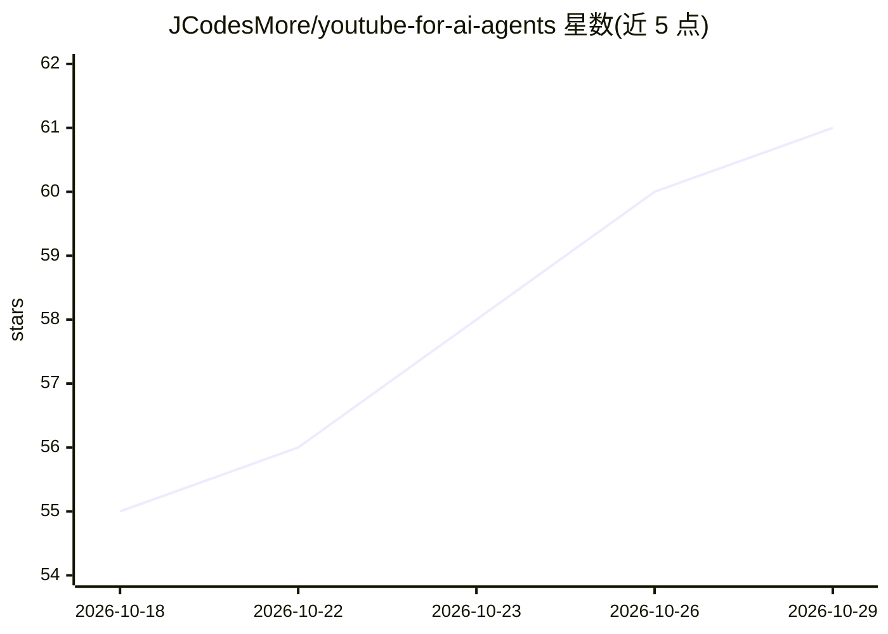

# JCodesMore/youtube-for-ai-agents

⭐ 61 · TypeScript · Apache-2.0 · 推送 2026-04-30 · [GitHub](https://github.com/JCodesMore/youtube-for-ai-agents) · [官网](https://dsc.gg/jcodesmore) · 个人维护

**让 Claude 在聊天中搜索、观看、剪辑 YouTube 视频的 Claude Code 插件**

Claude Code 的 YouTube 插件：以两个技能与一个 agent 的形式封装九个工具，使 Claude 能在对话中搜索视频/频道/播放列表、观看并总结长视频、抓取字幕、下载视频或音频、截取片段并合成集锦。安装方式为 Claude Code 内的 plugin 命令，无需 API key 或注册；可选通过 /youtube:setup 用自己的 YouTube cookies 登录以获得个性化搜索与推荐。面向使用 Claude Code 的终端用户。

## 筛选速览

| 维度 | 判定 | 备注 |
|---|---|---|
| AI 角色 | `ai-ecosystem` | LLM/agent 周边工具 |
| 许可风险 | `permissive` | Apache-2.0 |
| 部署形态 | `None` |  |
| 模型依赖 | locked-api |  |
| 硬件要求 | — | 无带数字的原话,不猜 |
| 安装摩擦 | `low` | 无编译、无系统依赖或容器化 |
| 成熟度 | — | 结构信号不足 |

## 能力要点

- 九个工具覆盖搜索、观看总结、字幕、下载、剪辑与集锦制作
- 以 Claude Code 插件形式安装，无需 API key 或注册
- 可选登录个人 YouTube cookies 获取个性化搜索与推荐

## 适用场景

- 让 AI 替我看长视频/播客并给出要点总结
- 在聊天中直接搜索并筛选高评分视频
- 截取视频片段或把多个视频合成集锦，无需打开浏览器

## 场景标签

`图像视频处理` `网页抓取` · 领域:效率与自动化

## 证据(README 行号)

> L19: **1. Install the plugin** — inside Claude Code, run:
> L47: **Nine smart tools** wrapped in **two skills** and **one agent** — search, watch, clip, and reel without leaving th

## 星数曲线

2026-10-18 55 → 2026-10-29 61（+6）

---
*卡片 v1 · prompt 1.4 · 生成 2026-10-24 · 置信度 high · 依据 README sha `3c3d186b088b` · [字段定义](../../DATASET.md)*
