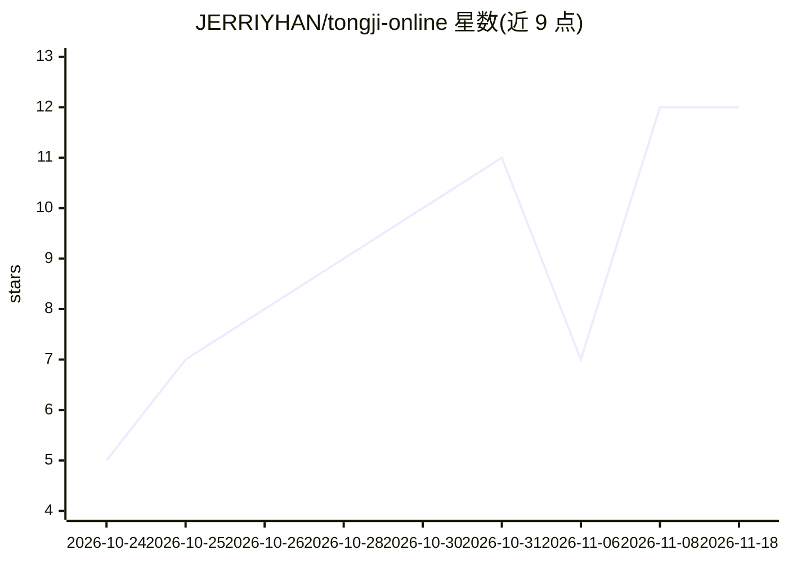

# JERRIYHAN/tongji-online

⭐ 12 · JavaScript · MIT · 推送 2026-10-23 · [GitHub](https://github.com/JERRIYHAN/tongji-online) · 个人维护 · 中文 README

**同济学生的 AI 技能包：自然语言查询校园服务**

以 Skill 形式分发的非官方同济校园工具：把 Canvas、图书馆、教务、一卡通、一网通办、体育场馆等网站的入口与操作方法交给 AI 助手，用户以自然语言提问。常用查询由本地 Node.js 脚本完成，更多功能由 Agent 沿网页导航探索；命令返回 JSON 便于后续处理。登录态保存在本机，认证由本地程序完成，无需向 AI 助手提供密码。运行需 Node.js 22+、Chrome/Edge 及支持本地技能执行的 AI 助手。

## 筛选速览

| 维度 | 判定 | 备注 |
|---|---|---|
| AI 角色 | `ai-native` | 本体是模型或模型工具 |
| 许可风险 | `permissive` | MIT |
| 部署形态 | `None` |  |
| 模型依赖 | — | README 未给出锁定关系 |
| 硬件要求 | — | 无带数字的原话,不猜 |
| 安装摩擦 | `low` | 无编译、无系统依赖或容器化 |
| 成熟度 | — | 结构信号不足 |

## 能力要点

- 覆盖 Canvas 作业、图书馆座位预约、教务成绩与学分分析、一卡通流水等 8 类场景
- 常用查询走本地脚本，网页操作由 Agent 导航完成
- 扫码登录、会话本地保存，凭据不上传 AI 服务
- 支持 Codex 等助手目录一键安装技能并附环境检查

## 适用场景

- 一句话查看未来七天截止的作业并整理成待办
- 按偏好查询并预约图书馆座位或研习室
- 分析培养计划学分缺口与社会实践进度
- 汇总一卡通半年消费明细

## 场景标签

`浏览器自动化` · 领域:效率与自动化

## 证据(README 行号)

> L18: 给 AI 助手装上 **tongji-online 技能包**，把校园网站的入口和操作方法交给它，你直接说需求。常用查询由本地脚本完成，更多功能由 Agent 沿着网站导航继续探索。
> L61: **运行环境**：Node.js 22+（含 npm）、Google Chrome 或 Microsoft Edge，以及能读取本地技能、执行命令和操作浏览器的 AI 助手。浏览器自动化复用已安装的 Chrome／Edge，无需另

## 星数曲线

2026-10-24 5 → 2026-11-18 12（+7）

---
*卡片 v1 · prompt 1.4 · 生成 2026-11-18 · 置信度 high · 依据 README sha `d2e518a0483b` · [字段定义](../../DATASET.md)*
