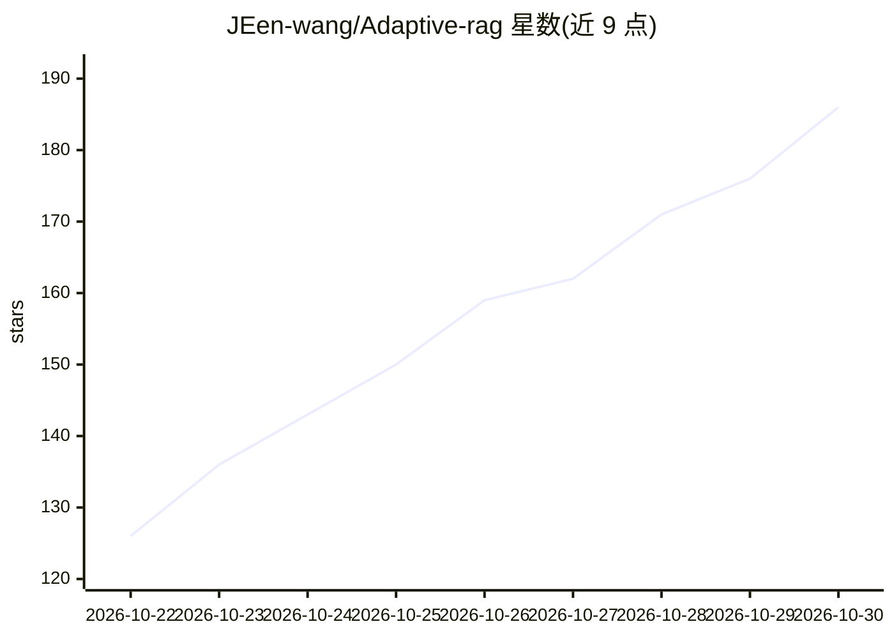

# JEen-wang/Adaptive-rag

⭐ 186 · Python · MIT · 推送 2026-10-22 · [GitHub](https://github.com/JEen-wang/Adaptive-rag) · 个人维护 · 中文 README

**按问题复杂度分流的电商客服多智能体 RAG 示例工程**

基于 FastAPI 与 LangGraph 的电商客服系统：五路策略路由（直接回答/单跳/多跳自纠错/工具调用/拒答），混合检索（BM25+稠密向量+RRF+Cross-Encoder 精排）并附带引用；查单、退改通过受权限约束的工具完成，高风险写操作返回 pending_action 待人工确认。无 API 密钥时进入离线证据模式。提供三档 Docker 部署、React Web 工作台、离线评测与 Prometheus 指标；README 附简历写法与面试问答文档，并声明为可运行工程示例、未认证 user_id，不应直接面向不可信用户开放。

## 筛选速览

| 维度 | 判定 | 备注 |
|---|---|---|
| AI 角色 | `ai-native` | 本体是模型或模型工具 |
| 许可风险 | `permissive` | MIT |
| 部署形态 | `self-host` | docker 或自建部署 |
| 模型依赖 | — | README 未给出锁定关系 |
| 硬件要求 | — | 无带数字的原话,不猜 |
| 安装摩擦 | `low` | 无编译、无系统依赖或容器化 |
| 成熟度 | — | 结构信号不足 |

## 能力要点

- 五路策略路由（DIRECT/SINGLE/MULTI/AGENT/REFUSE），回答带 strategy、citations 与 trace_id
- BM25+稠密向量+RRF+Cross-Encoder 混合检索与精排
- 高风险写操作 pending_action 人工确认、幂等与审计
- Redis/Qdrant/Embedding/精排不可用时分层降级，/capabilities 报告实际后端

## 适用场景

- 想学习 Adaptive-RAG 路由与 Self-RAG 工程实现的开发者跑通示例
- 搭建电商 FAQ/退换货政策客服原型并核验引用出处
- 作为简历项目准备 Agent/RAG 面试
- 体验带人工确认的订单查询与业务写操作流程

## 场景标签

`RAG` `多智能体` `聊天机器人` · 领域:Agent 开发

## 证据(README 行号)

> L3:  针对基于 FAQ 的传统客服系统长尾问题命中率极低，人工介入成本高的问题和常规 RAG 多跳推理能力差，幻觉问题严重的痛点设计并实现了基于 Adaptive-RAG 的多智能体电商客服系统。
> L44: 电商客服里的问题跨度很大。「你好」无需查知识库；退货政策需要可靠出处；「定制商品超过七天但有质量问题」要同时判断定制、时效与质量例外；取消订单则必须检查订单状态、权限与确认。项目用明确的路由策略处理这些差异，避免把所有输入都塞进同
> L62: |`AGENT`|查询订单、物流或发起业务操作|规划后调用受权限约束的工具|

## 星数曲线

2026-10-22 126 → 2026-10-30 186（+60）

---
*卡片 v1 · prompt 1.4 · 生成 2026-10-23 · 置信度 mid · 依据 README sha `9336e2497aac` · [字段定义](../../DATASET.md)*
