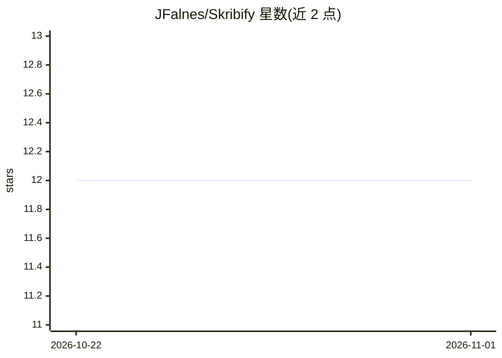

# JFalnes/Skribify

⭐ 12 · Python · GPL-3.0 · 推送 2026-10-21 · [GitHub](https://github.com/JFalnes/Skribify) · [官网](https://skribify.com) · 个人维护

**调用 GPT-4 与 Whisper 的本地音视频转录摘要工具**

Python 命令行工具/库：读取本地视频或音频文件，经 Whisper API 转录文本，再由 GPT-4（或 GPT-3.5）按自定义提示词生成摘要，支持仅转录模式。超 25MB 文件会分块顺序处理，README 提示可能引发分块处理问题。需要 OpenAI API key、Google API key 与系统安装的 FFMPEG（用于音频分块）。提供 CLI 与 Python 脚本调用两种用法，GPL-3.0 许可。

## 筛选速览

| 维度 | 判定 | 备注 |
|---|---|---|
| AI 角色 | `ai-native` | 本体是模型或模型工具 |
| 许可风险 | `viral` | GPL-3.0 |
| 部署形态 | `library` | 以包/库形式分发 |
| 模型依赖 | — | README 未给出锁定关系 |
| 硬件要求 | — | 无带数字的原话,不猜 |
| 安装摩擦 | `medium` | 含编译或系统依赖之一 |
| 成熟度 | — | 结构信号不足 |

## 能力要点

- 本地视频/音频文件转录并按自定义提示词摘要
- 超 25MB 文件自动分块顺序处理
- 提供 CLI 与 Python 库两种使用方式
- 可选 GPT-4（默认）或 GPT-3.5 模型

## 适用场景

- 我想把本地视频/音频转成文字记录
- 用自定义提示词从长音频中提取摘要
- 在 Python 脚本中集成转录回调处理

## 场景标签

`语音识别` `AI 写作` · 领域:内容生成

## 证据(README 行号)

> L2: Skribify is a powerful transcription and summarization tool that leverages the power of OpenAI's GPT-3.5 or GPT4 and
> L13: * Transcribe and summarize video or audio content.
> L55: If you're using files that exceed 25MB, they will be segmented into chunks and sequentially processed. This means t

## 星数曲线

2026-10-22 12 → 2026-11-01 12（+0）

---
*卡片 v1 · prompt 1.4 · 生成 2026-11-01 · 置信度 high · 依据 README sha `7392d4b4a122` · [字段定义](../../DATASET.md)*
