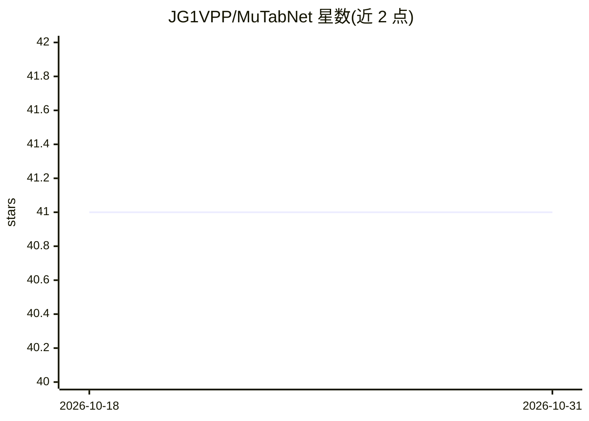

# JG1VPP/MuTabNet

⭐ 41 · Python · MIT · 推送 2026-09-23 · [GitHub](https://github.com/JG1VPP/MuTabNet) · [官网](https://arxiv.org/abs/2606.17874) · 个人维护

**表格结构识别模型官方实现：定位单元格并解码内容**

ICDAR 2026 论文的官方代码实现，提出 MuTabNet：通过全局自注意力精化单元格级结构表示，自回归多任务地定位表格单元格并解码其内容。以 PyTorch 项目形式提供，支持 pip install -e 安装，需先安装 PyTorch 2.4+；提供预处理、多卡训练（torchrun）与推理评测脚本（计算 TEDS 分数），训练需至少 4 张 NVIDIA V100 32GB GPU。使用 FinTabNet、PubTabNet 及 ICDAR Task-B 数据集，模型权重见 releases。

## 筛选速览

| 维度 | 判定 | 备注 |
|---|---|---|
| AI 角色 | `ai-native` | 本体是模型或模型工具 |
| 许可风险 | `permissive` | MIT |
| 部署形态 | `library` | 以包/库形式分发 |
| 模型依赖 | — | README 未给出锁定关系 |
| 硬件要求 | — | 无带数字的原话,不猜 |
| 安装摩擦 | `low` | 无编译、无系统依赖或容器化 |
| 成熟度 | — | 结构信号不足 |

## 能力要点

- 基于全局自注意力的单元格级结构表示，定位单元格并解码内容
- 提供预处理/训练/推理评测全流程脚本
- 以 TEDS 分数评测，FinTabNet 用 10,656 张表验证集作测试集

## 适用场景

- 研究人员复现 ICDAR 2026 论文的表格识别实验
- 在 FinTabNet/PubTabNet 上训练表格结构识别模型
- 评测表格识别的 TEDS 指标

## 场景标签

`文档解析` · 领域:知识与检索

## 证据(README 行号)

> L3: Official implementation of "Revisiting Structural Dependency in Autoregressive Multi-task Table Recognition via Orde
> L7: MuTabNet (2026) refines cell-level structural representations with global self-attention to accurately localize cell

## 星数曲线

2026-10-18 41 → 2026-10-31 41（+0）

---
*卡片 v1 · prompt 1.4 · 生成 2026-10-25 · 置信度 high · 依据 README sha `b3c1a2e5fd14` · [字段定义](../../DATASET.md)*
