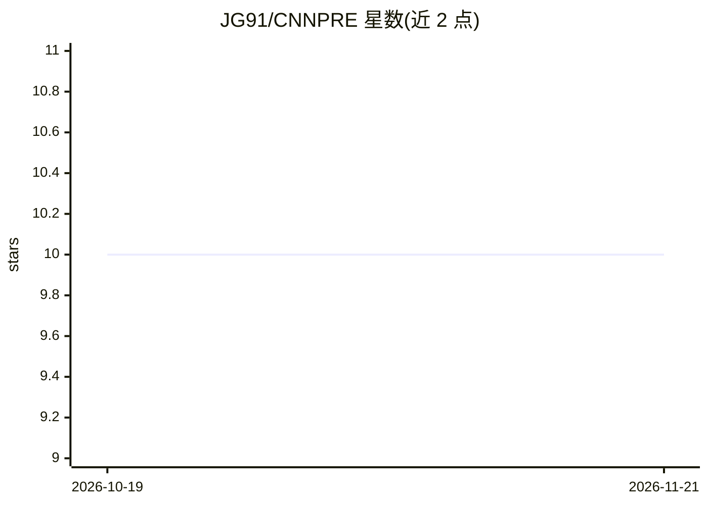

# JG91/CNNPRE

⭐ 10 · Jupyter Notebook · 推送 2026-01-13 · [GitHub](https://github.com/JG91/CNNPRE) · 个人维护

**基于 CNN 的协议逆向工程方法（消息类型识别）**

CNNPRE 是一种基于网络流量与流量特征的 CNN 协议逆向工程方法，用于消息类型识别，使用卷积神经网络（CNN）与深度迁移学习（DTL）。配套论文发表于 IEEE Access (2023)。README 提供可在 Google Colab 上运行的 cnnpre.ipynb notebook，并给出 WRCCDC 2021 区域赛 PCAP 数据集与 GSM PCAP 文件的下载来源，以及 Data 文件夹中的预处理 CSV 文件。

## 筛选速览

| 维度 | 判定 | 备注 |
|---|---|---|
| AI 角色 | `ai-native` | 本体是模型或模型工具 |
| 许可风险 | `none` | — |
| 部署形态 | `None` |  |
| 模型依赖 | — | README 未给出锁定关系 |
| 硬件要求 | — | 无带数字的原话,不猜 |
| 安装摩擦 | `low` | 无编译、无系统依赖或容器化 |
| 成熟度 | — | 结构信号不足 |

## 能力要点

- 基于 CNN 与深度迁移学习的消息类型识别方法
- 提供可在 Google Colab 运行的 notebook
- 提供 WRCCDC 2021 PCAP 与预处理 CSV 数据集
- 配套 IEEE Access 2023 论文

## 适用场景

- 对网络流量做消息类型识别以辅助协议逆向分析
- 在 Colab 上复现论文实验流程
- 使用公开 WRCCDC/GSM PCAP 数据研究流量分类

## 场景标签

 · 领域:网络安全/协议分析

## 证据(README 行号)

> L5: A CNN-Based PRE method for Message Type Identification based on network traffic and traffic features, which is used 
> L14: You can run cnnpre.ipynb notebook on Google Colab

## 星数曲线

2026-10-19 10 → 2026-11-21 10（+0）

---
*卡片 v1 · prompt 1.4 · 生成 2026-11-20 · 置信度 high · 依据 README sha `95856a175c79` · [字段定义](../../DATASET.md)*
