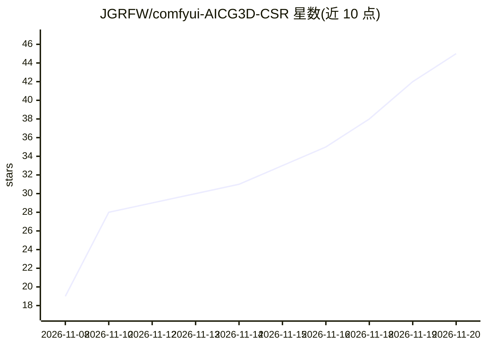

# JGRFW/comfyui-AICG3D-CSR

⭐ 45 · Python · MIT · 推送 2026-11-06 · [GitHub](https://github.com/JGRFW/comfyui-AICG3D-CSR) · 个人维护 · 中文 README

**ComfyUI 节点包：MiniMax H3 人物/场景/产品替换的视频流水线**

面向 ComfyUI 与 MiniMax H3 的独立替换节点包，把视频裁切、分段生成、逐段落盘、断点续跑、可选二采放大、静音合并与音轨后封装组织成单线工作流。支持 360P–1080P 与自定义分辨率，接缝处做曝光锁定与亮度过渡处理。提示词优化器可接入 Ollama、LM Studio、llama.cpp 等 OpenAI 兼容 API 或本地 GGUF；视觉分析默认关闭。运行需系统提供同源的 ffmpeg 与 ffprobe，模型权重不随仓库提供。

## 筛选速览

| 维度 | 判定 | 备注 |
|---|---|---|
| AI 角色 | `ai-native` | 本体是模型或模型工具 |
| 许可风险 | `permissive` | MIT |
| 部署形态 | `desktop` | 安装包/桌面程序 |
| 模型依赖 | local-ok | 支持本地模型 |
| 硬件要求 | — | 无带数字的原话,不猜 |
| 安装摩擦 | `medium` | 含编译或系统依赖之一 |
| 成熟度 | — | 结构信号不足 |

## 能力要点

- 分段即保存，中断后仅补未完成段落
- 音轨先剥离后封装，生成分段全程静音
- 可选二采：3D latent 放大、独立模型/采样器/断点续跑
- 提示词优化器支持 Ollama/LM Studio/llama.cpp 等 OpenAI 兼容 API 与本地 GGUF

## 适用场景

- 长视频中替换人物、场景或产品并保持跨段连贯
- 昂贵生成任务中断后按段续跑不重做
- 对替换结果做二采放大精细化

## 场景标签

`视频生成` `图像视频处理` · 领域:内容生成

## 证据(README 行号)

> L6: `comfyui-AICG3D-CSR` 是面向 ComfyUI 与 MiniMax H3 的独立人物、场景、物品和产品替换节点包。它把长视频替换里最容易断裂的环节连成一条单线工作流，并让每一段生成结果都能立即保存、检查和续跑。
> L65: `MiniMax H3 Aicg 加载器 -> MiniMax H3 Aicg 视频裁剪 -> MiniMax H3 Aicg资源库 -> CSR ③ -> CSR ③B 二采（可选） -> CSR ④ -> SaveVideo`
> L102: - Generate each segment independently and save its MP4 immediately.

## 星数曲线

2026-11-08 19 → 2026-11-20 45（+26）

---
*卡片 v1 · prompt 1.4 · 生成 2026-11-18 · 置信度 mid · 依据 README sha `b87d3b4e36b3` · [字段定义](../../DATASET.md)*
