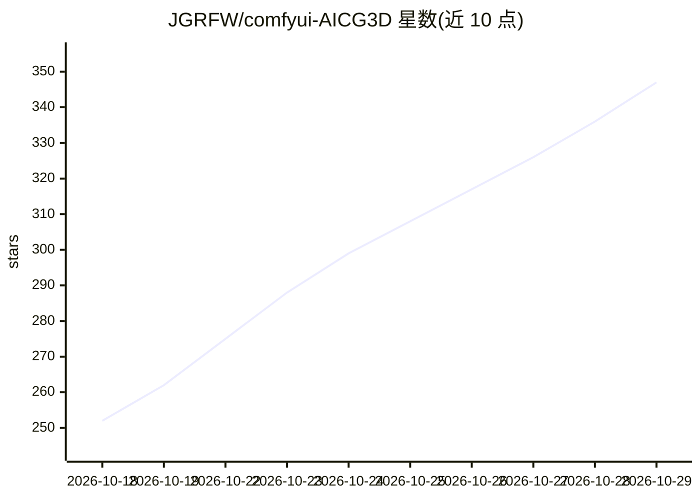

# JGRFW/comfyui-AICG3D

⭐ 347 · Python · GPL-3.0 · 推送 2026-10-28 · [GitHub](https://github.com/JGRFW/comfyui-AICG3D) · [官网](https://github.com/JGRFW/comfyui-AICG3D) · 组织维护 · 中文 README

**ComfyUI 插件：基于 MiniMax H3 生成本地无限时长短剧视频**

面向 AI 视频创作者的 ComfyUI 自定义节点包（ComfyUI-AICG3D-Integrated），整合 MiniMax H3 生成能力：长剧本智能分段解析、五种任务模式（T2VA/I2VA/FL2VA/REF2VA/L2VA）、分段尾帧续写与最终合成、Latent 放大、外部采样器与 DMAD 四步加速 LoRA，以及段落间接缝曝光与运动桥处理，实现本地无限时长视频生成。所有节点采用 AICG3D_H3_ 强制唯一前缀以避免节点同名冲突。可经 Comfy Registry 或复制到 custom_nodes/ 安装；13 号工作流最终合成需要 FFmpeg。基于社区多个 MiniMax H3 项目工程化整合而成。

## 筛选速览

| 维度 | 判定 | 备注 |
|---|---|---|
| AI 角色 | `ai-native` | 本体是模型或模型工具 |
| 许可风险 | `viral` | GPL-3.0 |
| 部署形态 | `desktop` | 安装包/桌面程序 |
| 模型依赖 | local-ok | 支持本地模型 |
| 硬件要求 | — | 无带数字的原话,不猜 |
| 安装摩擦 | `medium` | 含编译或系统依赖之一 |
| 成熟度 | — | 结构信号不足 |

## 能力要点

- 长剧本自动分段映射至视频时间轴，分段续写并最终合成无限时长视频
- 五种 H3 任务模式（Ref2VA/T2VA/I2VA/FL2VA/L2VA）切换生成行为
- 节点强制唯一命名空间（AICG3D_H3_ 前缀），与其他 MiniMax 分支共存
- 支持外部采样器/Sigmas 与 DMAD 四步加速（LoRA×1.0、步数4、shift12）

## 适用场景

- 在 ComfyUI 里本地生成分段拼接的短剧/长视频
- 用长剧本自动分段并按段落引用图片/音频/视频素材
- 通过接缝曝光锁定与运动桥保持分段画面连续

## 场景标签

`视频生成` · 领域:内容生成

## 证据(README 行号)

> L9: 短剧工作台（ComfyUI-AICG3D-Integrated）是一个专为专业 AI 视频创作者打造的深度整合插件包。它将 MiniMax H3 的核心生成能力、智能分段解析与高阶渲染策略集成于一体，旨在为用户提供一个**零冲突、工
> L93: - **五种 H3 任务模式已接入执行链**：`Ref2VA 全能参考（推荐）`、`T2VA 纯文本`、`I2VA 首帧参考`、`FL2VA 首尾帧参考`、`L2VA 尾帧参考`。
> L166: - **智能剧本分段 (PromptSplit)**：支持将长剧本/提示词自动拆分为逻辑段落 -> 一键映射至视频时间轴 -> 自动优化随机种子。

## 星数曲线

2026-10-18 252 → 2026-10-29 347（+95）

---
*卡片 v1 · prompt 1.4 · 生成 2026-10-22 · 置信度 mid · 依据 README sha `c2339b583c0d` · [字段定义](../../DATASET.md)*
