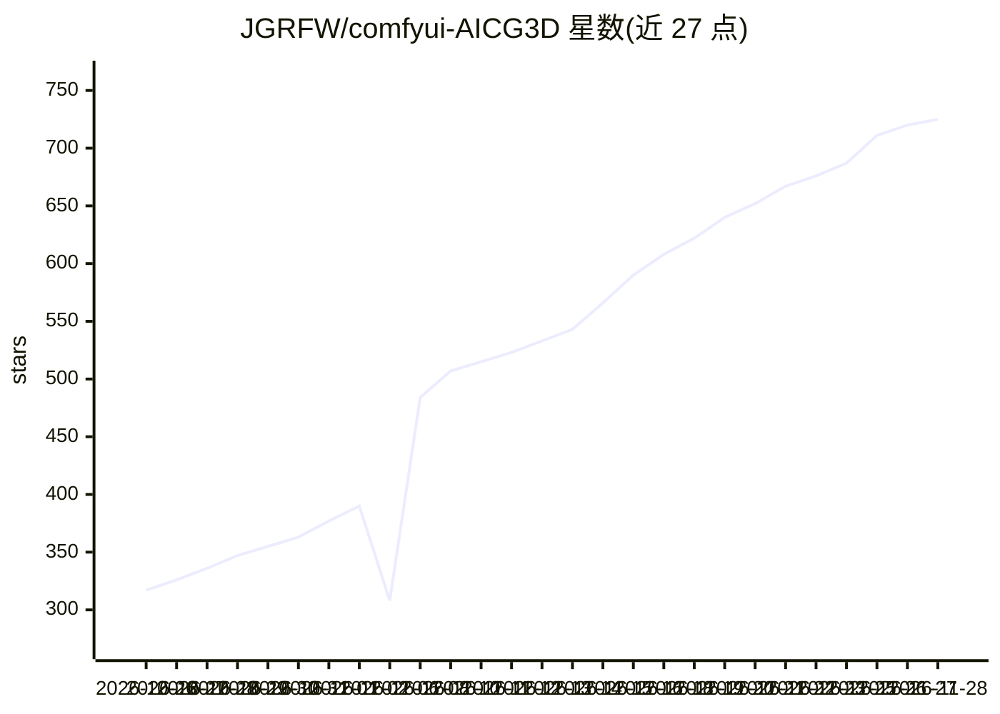

# JGRFW/comfyui-AICG3D

⭐ 725 · Python · GPL-3.0 · 推送 2026-11-15 · [GitHub](https://github.com/JGRFW/comfyui-AICG3D) · [官网](https://github.com/JGRFW/comfyui-AICG3D) · 个人维护 · 中文 README

**给 AI 视频创作者的 ComfyUI 插件：MiniMax H3 本地无限长视频工作流**

ComfyUI 自定义节点插件包，围绕 MiniMax H3 模型组织视频生成流程：剧本自动分段（PromptSplit）、无限分段长视频、二采放大与 SeedVR2/RTX VSR/VOSR2 修复链、角色音色库（内置 Spark-TTS 推理源码，权重需单独下载）、素材资源库引用等。采用 AICG3D_H3_ 唯一命名空间避免与同名 H3 插件冲突。核心包零强制依赖，TTS/提示词优化/FFmpeg 合成为可选依赖；面向专业 AI 视频创作者。

## 筛选速览

| 维度 | 判定 | 备注 |
|---|---|---|
| AI 角色 | `ai-native` | 本体是模型或模型工具 |
| 许可风险 | `viral` | GPL-3.0 |
| 部署形态 | `desktop` | 安装包/桌面程序 |
| 模型依赖 | local-ok | 支持本地模型 |
| 硬件要求 | — | 无带数字的原话,不猜 |
| 安装摩擦 | `medium` | 含编译或系统依赖之一 |
| 成熟度 | — | 结构信号不足 |

## 能力要点

- 13 号无限分段长视频工作流：FL2VA+REF2VA 混合路线、接缝曝光锁定、最终合成
- 六角色音色库：描述音色与 5～15 秒参考音频克隆，跨段音色锁定
- DMAD 四步加速（LoRA 强度 1.0、步数 4）与外部采样器/Sigmas 接口
- AICG3D_H3_ 强制唯一命名空间，避免同名插件节点覆盖

## 适用场景

- 本地生成无限时长的分段短剧视频
- 制作多角色对白并克隆固定音色的数字人视频
- 对成片进行二采放大与逐级修复

## 场景标签

`视频生成` `语音合成` · 领域:内容生成

## 证据(README 行号)

> L7:  ComfyUI · MiniMax H3 · 本地无限长视频生成工作流
> L11: 短剧工作台（comfyui-AICG3D）是一个专为专业 AI 视频创作者打造的深度整合插件包。它将 MiniMax H3 的核心生成能力、智能分段解析与高阶渲染策略集成于一体，旨在为用户提供一个**节点命名空间隔离、可维护、可预
> L296: 推荐直接在 **ComfyUI Manager / Comfy Registry** 搜索 `AICG3D`、`短剧工作台` 或 `MiniMax H3` 安装。核心包保持零强制依赖；角色音色、试听、提示词远程优化和 FFmpe

## 星数曲线

2026-10-26 317 → 2026-11-28 725（+408）

---
*卡片 v1 · prompt 1.4 · 生成 2026-11-25 · 置信度 high · 依据 README sha `b5f6925e9f61` · [字段定义](../../DATASET.md)*
