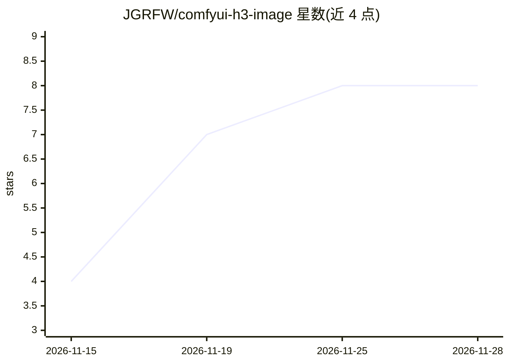

# JGRFW/comfyui-h3-image

⭐ 8 · JavaScript · MIT · 推送 2026-11-11 · [GitHub](https://github.com/JGRFW/comfyui-h3-image) · [官网](https://huggingface.co/PrunaAI/p-h3-image-comfy) · 个人维护 · 中文 README

**ComfyUI 用户封装 MiniMax H3 文生图/图片编辑工作流**

为 p-h3-image / MiniMax H3 Image 提供的 ComfyUI 自定义节点封装，将官方长工作流收进 3 个节点（加载器、九宫格资源库、生成节点），保留官方条件编码、Sigma 曲线与 er_sde 采样。支持文生图、单图编辑与多参考图编辑，九宫格资源库最多 9 张图经一条连线传递，附主 LoRA 与最多 9 个附加 LoRA 的独立权重控制。无额外 Python 依赖，复用 ComfyUI 已装的核心节点，模型权重需手动下载到本地目录。

## 筛选速览

| 维度 | 判定 | 备注 |
|---|---|---|
| AI 角色 | `ai-native` | 本体是模型或模型工具 |
| 许可风险 | `permissive` | MIT |
| 部署形态 | `None` |  |
| 模型依赖 | — | README 未给出锁定关系 |
| 硬件要求 | — | 无带数字的原话,不猜 |
| 安装摩擦 | `low` | 无编译、无系统依赖或容器化 |
| 成熟度 | — | 结构信号不足 |

## 能力要点

- 文生图 3 节点、图片编辑 4 节点的精简工作流
- 3×3 九宫格资源库单线传递 9 张图，支持拖拽与排序
- 主 LoRA + 最多 9 个附加 LoRA，独立文件选择与权重
- 比例与 480P 至 4K 画质联动，默认官方 8 步 Sigma 曲线

## 适用场景

- 在 ComfyUI 中快速运行 MiniMax H3 文生图工作流
- 上传原图与参考图做多图编辑
- 按比例与画质档位批量控制输出尺寸

## 场景标签

`图像生成` · 领域:内容生成

## 证据(README 行号)

> L11: 一个为 **p-h3-image / MiniMax H3 Image** 做的 ComfyUI 精简封装。把官方长工作流收进三个节点，保留官方条件编码、Sigma 曲线、`er_sde` 采样与 VAE 解码，同时提供九宫格图片
> L35: |H3 Image 生成|`H3ImageGenerate`|文生图、单图编辑和多参考图编辑，直接输出 `IMAGE`|

## 星数曲线

2026-11-15 4 → 2026-11-28 8（+4）

---
*卡片 v1 · prompt 1.4 · 生成 2026-11-20 · 置信度 high · 依据 README sha `4fe52d3255cc` · [字段定义](../../DATASET.md)*
