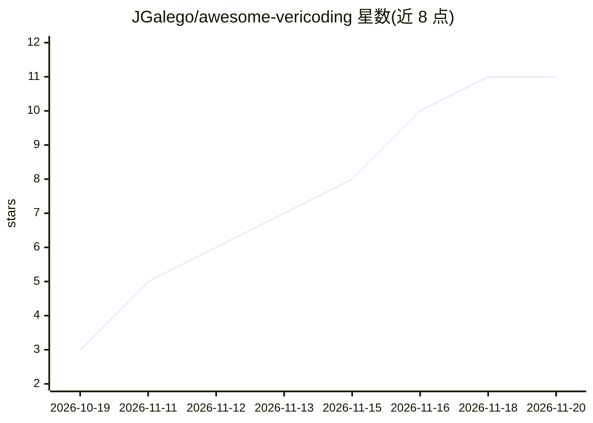

# JGalego/awesome-vericoding

⭐ 11 · Python · CC0-1.0 · 推送 2026-11-17 · [GitHub](https://github.com/JGalego/awesome-vericoding) · [官网](https://jgalego.github.io/awesome-vericoding) · 个人维护

**形式化验证代码资源清单：人工与 AI 生成代码+证明**

以 CC0-1.0 许可发布的精选资源列表，围绕 vericoding——让代码附带满足规范的形式化证明并交由验证器检查。内容按经典验证（人工写证明）与 AI vericoding（模型/agent 在验证器反馈下生成代码与证明）两条线索组织，收录验证感知语言（Dafny、F*、SPARK 等）、主流语言验证器（C/Rust/Java/Go 等）、论文、教程与博客，并标注入门推荐与生产使用标记。

## 筛选速览

| 维度 | 判定 | 备注 |
|---|---|---|
| AI 角色 | `ai-knowledge` | 知识聚合/清单类 |
| 许可风险 | `viral` | CC0-1.0 |
| 部署形态 | `None` |  |
| 模型依赖 | — | README 未给出锁定关系 |
| 硬件要求 | — | 无带数字的原话,不猜 |
| 安装摩擦 | `medium` | 含编译或系统依赖之一 |
| 成熟度 | — | 结构信号不足 |

## 能力要点

- 覆盖经典与 AI 两类 vericoding 资源，含定义与分类对照表
- 收录验证感知语言与 C/Rust/Java/Go/Python 等语言的验证器清单
- 提供入门路径：Dafny 教程、Lean Natural Number Game、Let's Prove Leftpad
- 条目带 ⭐/🏭/💰 标记区分入门、生产使用与付费资源

## 适用场景

- 查找给 AI 生成代码做形式化验证的工具与论文
- 从零学习 Dafny 或 Lean 等证明辅助工具
- 对比不同语言的验证器以选择验证方案

## 场景标签

`精选清单` · 领域:学习与行业

## 证据(README 行号)

> L1: # Awesome Vericoding Awesome
> L13: Bursuc *et al.* (2025) coined the term for LLM-generated, formally verified code, but people were doing the same th
> L33: ## Contents

## 星数曲线

2026-10-19 3 → 2026-11-20 11（+8）

---
*卡片 v1 · prompt 1.4 · 生成 2026-11-19 · 置信度 high · 依据 README sha `af51c1a9d333` · [字段定义](../../DATASET.md)*
