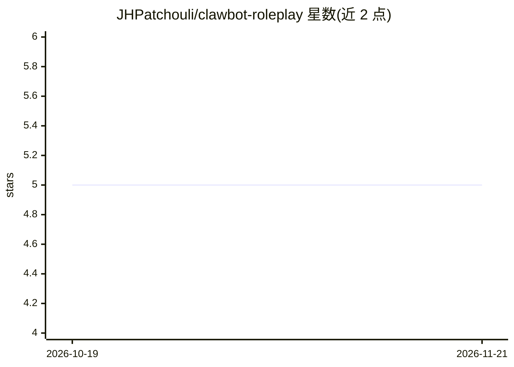

# JHPatchouli/clawbot-roleplay

⭐ — · [GitHub]() · 个人维护 · 中文 README

**面向 ClawBot 微信接口的角色扮演聊天后端**

运行于 Node.js 20+ 的后端服务，不包含管理前端，模型、角色、记忆与调度全部通过聊天命令配置并保存为 JSON。角色卡、世界书与会话历史分开存储，长期记忆采用关键词与进程内余弦向量融合检索，区分会话与全局范围；每轮注入配置地点的天气与当前时间；命令、感知源与模型工具各自独立注册。语音转文字处于实验阶段，图片/视频理解处于开发中。

## 筛选速览

| 维度 | 判定 | 备注 |
|---|---|---|
| AI 角色 | `ai-native` | 本体是模型或模型工具 |
| 许可风险 | `viral` | — |
| 部署形态 | `self-host` | docker 或自建部署 |
| 模型依赖 | — | README 未给出锁定关系 |
| 硬件要求 | — | 无带数字的原话,不猜 |
| 安装摩擦 | `low` | 无编译、无系统依赖或容器化 |
| 成熟度 | — | 结构信号不足 |

## 能力要点

- 长期记忆支持关键词与向量融合检索，区分会话与全局范围
- 每轮注入当前时间与多地点天气，位置需显式配置
- 模型经 OpenAI 兼容 HTTP 接口接入，服务商/模型/密钥可切换
- 每轮变化信息追加在用户输入后以保留前缀缓存

## 适用场景

- 在微信上与多个人设角色进行跨轮次的长对话
- 让角色按现实时间主动发起消息
- 学习和二次开发机器人后端的插件化组织方式

## 场景标签

`聊天机器人` · 领域:对话与助手

## 证据(README 行号)

> L5: 基于 ClawBot 微信接口的可扩展角色扮演后端，支持角色卡、长期记忆、工具调用、时间与天气感知。
> L61: |模型|OpenAI 兼容 HTTP 接口；服务商、模型和密钥可切换|
> L75: |模型|服务商切换、工具调用、任务委托|可用|

## 星数曲线

2026-10-19 5 → 2026-11-21 5（+0）

---
*卡片 v1 · prompt 1.4 · 生成 2026-11-21 · 置信度 high · 依据 README sha `310be68b8c14` · [字段定义](../../DATASET.md)*
