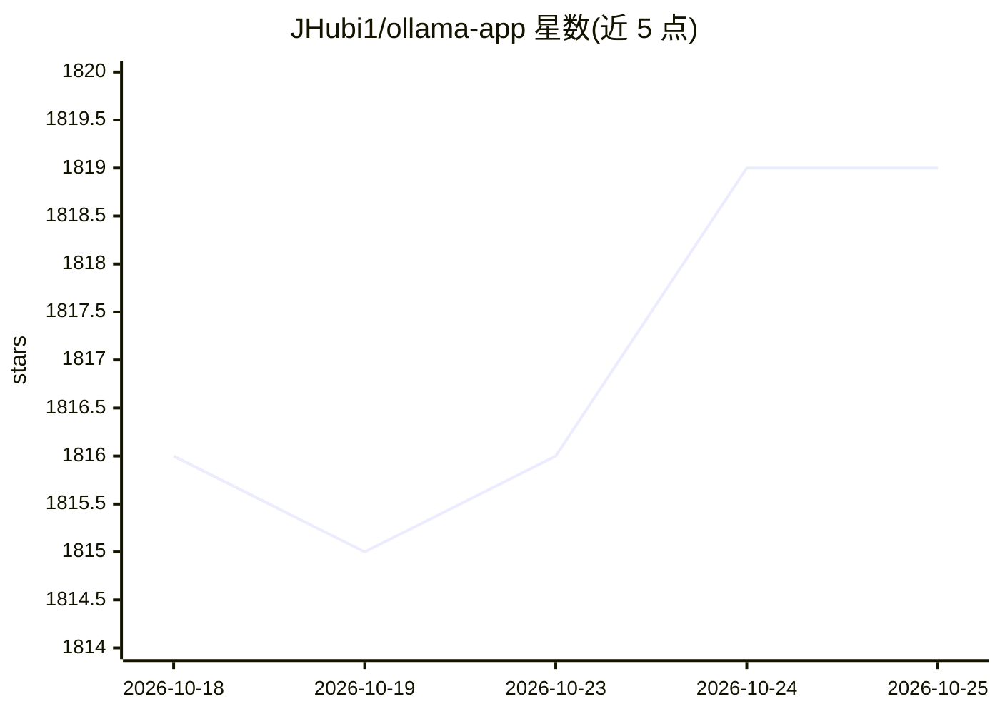

# JHubi1/ollama-app

⭐ 1,819 · Dart · Apache-2.0 · 推送 2026-10-03 · [GitHub](https://github.com/JHubi1/ollama-app) · 个人维护

**连接本地 Ollama 服务的多平台聊天客户端应用**

面向终端用户的 Ollama 客户端：设备上不运行 Ollama 服务器，而是通过 API endpoint 连接到已有服务进行本地聊天，数据保留在本地网络。基于 Flutter 构建，支持 Android、Windows 与 Linux 等多平台，桌面版为实验性功能。安装方式包括 releases 页面的可执行文件、各应用商店、Windows 安装包与 Linux 便携可执行文件；Linux 上可能需额外安装 GTK3 相关系统库。还提供实验性的语音模式。

## 筛选速览

| 维度 | 判定 | 备注 |
|---|---|---|
| AI 角色 | `ai-ecosystem` | LLM/agent 周边工具 |
| 许可风险 | `permissive` | Apache-2.0 |
| 部署形态 | `None` |  |
| 模型依赖 | local-ok | 支持本地模型 |
| 硬件要求 | — | 无带数字的原话,不猜 |
| 安装摩擦 | `low` | 无编译、无系统依赖或容器化 |
| 成熟度 | `idea` | |

## 能力要点

- 通过 API endpoint 连接已有 Ollama 服务器，不在设备上托管服务
- 基于 Flutter 单一代码库覆盖多平台（含商店分发）
- Windows 提供安装包，Linux 提供便携可执行文件
- 实验性语音模式（Voice Mode）

## 适用场景

- 在手机或桌面设备上与本地 Ollama 服务对话
- 在本地网络内私密使用本地大模型
- 不依赖命令行、以图形界面使用 Ollama

## 场景标签

`聊天机器人` · 领域:对话与助手

## 证据(README 行号)

> L9: > This app does not host a Ollama server on device, but rather connects to one using its api endpoint.
> L3: A modern and easy-to-use client for Ollama. Have the greatest experience while keeping everything private and in you

## 星数曲线

2026-10-18 1,816 → 2026-10-25 1,819（+3）

---
*卡片 v1 · prompt 1.4 · 生成 2026-10-21 · 置信度 high · 依据 README sha `b3abc4c7d4f3` · [字段定义](../../DATASET.md)*
