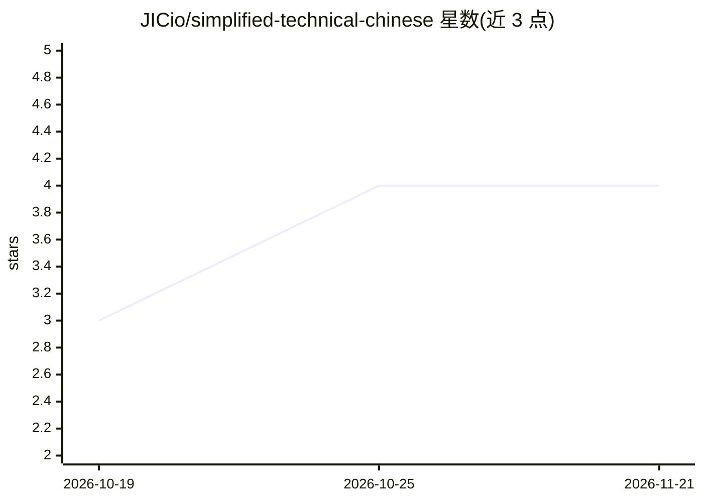

# JICio/simplified-technical-chinese

⭐ 4 · CC-BY-4.0 · 推送 2026-10-11 · [GitHub](https://github.com/JICio/simplified-technical-chinese) · 组织维护 · 中文 README

**给人与 LLM 使用的中文受控写作规则规范与提示模板**

参照航空维修受控英语 ASD-STE100、按中文语法重建的写作规范草案（STC-0.1）：8 个部分、60 条规则，每条标注【必】或【宜】，分简体与繁体两套规范。仓库提供三份提示模板（严格版、80% 版、改写版）及可直接放入 CLAUDE.md 或 system prompt 的规则文件。为写技术文档的人和使用 LLM 生成中文内容的场景设计；声明为非官方草案，与 ASD 无隶属关系。

## 筛选速览

| 维度 | 判定 | 备注 |
|---|---|---|
| AI 角色 | `ai-knowledge` | 知识聚合/清单类 |
| 许可风险 | `viral` | CC-BY-4.0 |
| 部署形态 | `None` |  |
| 模型依赖 | — | README 未给出锁定关系 |
| 硬件要求 | — | 无带数字的原话,不猜 |
| 安装摩擦 | `low` | 无编译、无系统依赖或容器化 |
| 成熟度 | — | 结构信号不足 |

## 能力要点

- 8 部分、60 条规则的中文写作规范，简体与繁体（台湾用语）各一套
- 每条规则标注【必】MUST 或【宜】SHOULD，支持 100% 与约 80% 两档执行强度
- 提供严格版、80% 版、改写版三份 LLM 提示模板，简繁各一套
- 提供可直接复制进 CLAUDE.md 或 system prompt 的规则文件

## 适用场景

- 为手册和 SOP 制定统一的中文写作规范
- 让 LLM 按固定规则生成或改写中文技术文档
- 审查已有中文文本并标记缺失事实（【待补】）而非让模型猜测

## 场景标签

`提示工程` `AI 写作` · 领域:Agent 开发

## 证据(README 行号)

> L3: **Writing rules for Chinese text that people and LLMs can read once and understand once.**
> L26: |`prompts/`|Three LLM prompt templates per script: strict, 80%, rewrite · 三份提示模板（严格版、80% 版、改写版），简繁各一套|

## 星数曲线

2026-10-19 3 → 2026-11-21 4（+1）

---
*卡片 v1 · prompt 1.4 · 生成 2026-11-21 · 置信度 high · 依据 README sha `5df5f8834aa6` · [字段定义](../../DATASET.md)*
