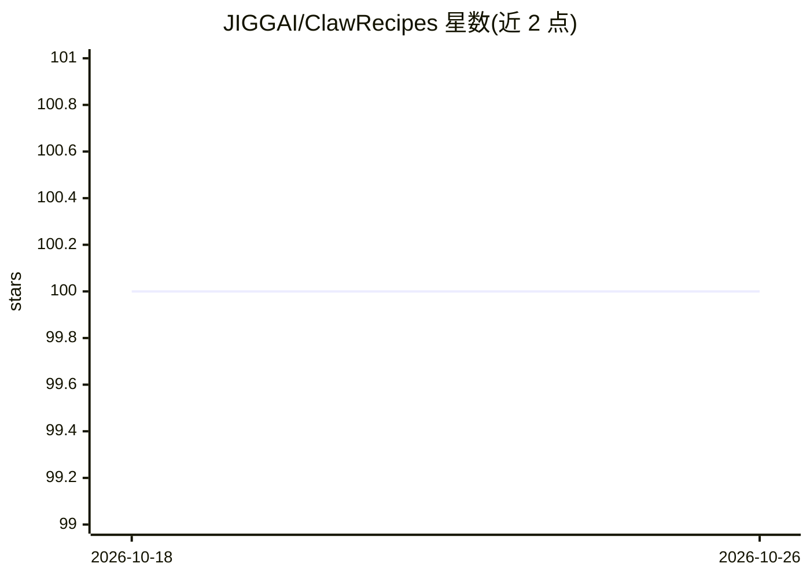

# JIGGAI/ClawRecipes

⭐ 100 · TypeScript · Apache-2.0 · 推送 2026-10-14 · [GitHub](https://github.com/JIGGAI/ClawRecipes) · [官网](https://clawkitchen.ai) · 个人维护

**OpenClaw 插件：用 Markdown 配方脚手架化 agent 团队与文件优先工作流**

ClawRecipes 是一个 OpenClaw 插件（TypeScript/Node.js 18+），以 CLI 优先方式提供 15+ 个 Markdown 编写的配方，用于脚手架生成单个 agent 或团队（角色、工单泳道、可选 agent 配置），并运行文件优先的工单流（dispatch→backlog→in-progress→testing→done）。工作流支持审批门控、工具节点与 LLM 节点，附带四个营销/发布示例。默认构建不自动启用工作流对外发布，需另行配置 outbound 服务或重打补丁。可选配 ClawKitchen 提供 UI。

## 筛选速览

| 维度 | 判定 | 备注 |
|---|---|---|
| AI 角色 | `ai-ecosystem` | LLM/agent 周边工具 |
| 许可风险 | `permissive` | Apache-2.0 |
| 部署形态 | `library` | 以包/库形式分发 |
| 模型依赖 | — | README 未给出锁定关系 |
| 硬件要求 | — | 无带数字的原话,不猜 |
| 安装摩擦 | `low` | 无编译、无系统依赖或容器化 |
| 成熟度 | — | 结构信号不足 |

## 能力要点

- Markdown 配方驱动 agent/团队脚手架（scaffold / scaffold-team）
- 文件优先工单流：dispatch→backlog→in-progress→testing→done
- 工作流引擎含审批门控、工具节点、LLM 节点与定时任务
- 四个可运行示例工作流（营销文案/图像/视频生成与社媒发布）

## 适用场景

- 一条命令为 OpenClaw 搭建多 agent 开发团队
- 用文件优先工单流分配与跟踪 agent 任务
- 运行审批门控的定时营销内容生成与发布工作流

## 场景标签

`多智能体` `工作流自动化` · 领域:Agent 开发

## 证据(README 行号)

> L16: ClawRecipes is an **OpenClaw plugin** for scaffolding agents, teams, and file-first workflows from Markdown recipes
> L31: - **agent scaffolding** (`openclaw recipes scaffold`)
> L33: - **file-first ticket workflow** (`dispatch → backlog → in-progress → testing → done`)

## 星数曲线

2026-10-18 100 → 2026-10-26 100（+0）

---
*卡片 v1 · prompt 1.4 · 生成 2026-10-23 · 置信度 high · 依据 README sha `f69756af57e9` · [字段定义](../../DATASET.md)*
