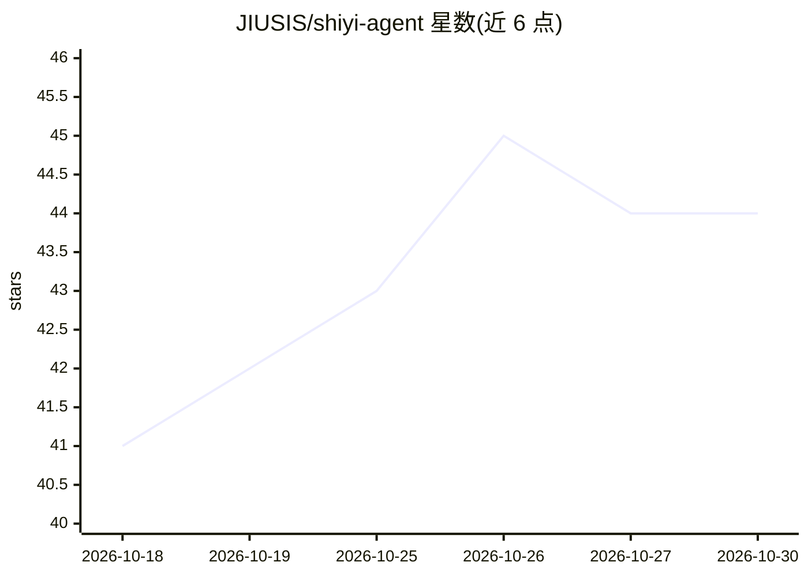

# JIUSIS/shiyi-agent

⭐ 44 · Dart · GPL-3.0 · 推送 2026-10-15 · [GitHub](https://github.com/JIUSIS/shiyi-agent) · [官网](https://github.com/JIUSIS/shiyi-agent/releases) · 个人维护 · 中文 README

**Android/Windows 个人 AI 工作台：读写文件、跑命令、多 Agent 协作**

Flutter 编写的跨平台（Android/Windows）个人 AI 工作台，把 LLM 对话、长期记忆、项目文件管理、技能系统、子代理与多 Agent 群聊、内置 Alpine 终端整合为一个应用。可切换拾忆本地引擎或 DeepSeek Harness，内置 OpenAI/Anthropic/Gemini/DeepSeek 等 API 预设。Android 端内嵌 proot + Alpine minirootfs（约 3.9MB）终端，无需 Termux，无 root 设备可能受 SELinux 限制；Windows 端使用 WSL/Git Bash/PowerShell/cmd。会话与记忆默认存本地。Android 提供 APK，Windows 需从源码用 Flutter 构建。GPL-3.0 开源。

## 筛选速览

| 维度 | 判定 | 备注 |
|---|---|---|
| AI 角色 | `ai-native` | 本体是模型或模型工具 |
| 许可风险 | `viral` | GPL-3.0 |
| 部署形态 | `None` |  |
| 模型依赖 | locked-api |  |
| 硬件要求 | — | 无带数字的原话,不猜 |
| 安装摩擦 | `low` | 无编译、无系统依赖或容器化 |
| 成熟度 | — | 结构信号不足 |

## 能力要点

- 子代理并行派发（explore/plan/worker/general-purpose 四类，写路径隔离、轮数预算）
- 多 Agent 群聊：粘贴思维导图生成团队，层级行动调度，成员用完整工具集
- Android 内嵌 Alpine Linux 终端（proot + minirootfs 约 3.9MB），无需另装 Termux
- LAAP 本地认知皮层提供持续内在状态，默认关闭可单独启用

## 适用场景

- 在手机上让 AI 直接读写项目文件、运行命令完成实际工作
- 通过思维导图组建多 Agent 团队并行处理任务
- 用子代理把复杂任务拆分成只读侦查、方案设计与执行分工
- 通过技能系统按固定流程反复执行资料整理、报告生成等任务

## 场景标签

`AI 助手` `多智能体` · 领域:Agent 开发

## 证据(README 行号)

> L16: 拾忆（ShiYi）是一款运行在 Android 手机与 Windows 桌面的个人 AI 工作台。它将大语言模型、长期记忆、项目文件管理、内置终端与技能系统整合为一个应用，并可切换拾忆本地引擎或 DeepSeek Harness。
> L3: > 运行在 Android 手机与 Windows 桌面的个人 AI 工作台 —— 让 AI 不只是回答问题，而是参与你的实际工作：读取资料、修改文件、运行命令、整理项目。
> L75: - Android 端底部「终端」栏与 AI 的 `run_terminal` 共用内嵌 Alpine（bash / python3 / apk），**无需另装 Termux**；点画面输入，输入 / 输出 / 警告 / 错误分色

## 星数曲线

2026-10-18 41 → 2026-10-30 44（+3）

---
*卡片 v1 · prompt 1.4 · 生成 2026-10-25 · 置信度 high · 依据 README sha `d16fd7f4fd46` · [字段定义](../../DATASET.md)*
