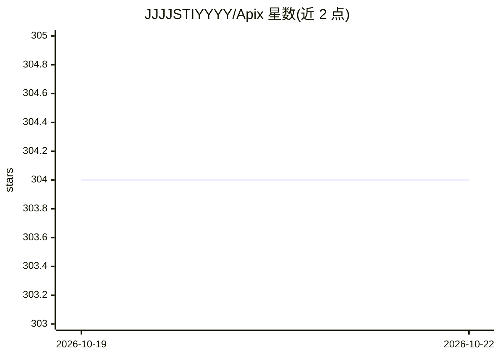

# JJJJSTIYYYY/Apix

⭐ 304 · Vue · GPL-3.0 · 推送 2026-10-17 · [GitHub](https://github.com/JJJJSTIYYYY/Apix) · 个人维护 · 中文 README

**全栈 AI Agent 协作平台：多智能体并行、沙箱执行与知识库**

基于 FastAPI + Vue + Electron 的完整 Agent 运行时：Leader 调度多个子代理并行协作并做文件访问冲突检测，代码在 Docker 沙箱中隔离执行，内置以工作区划分的记忆系统与多级自动上下文压缩。工具生态覆盖代码执行、文件管理、网络搜索、知识检索；支持卡片化任务流编辑、角色卡、MCP 多协议与消息节点分支管理。模型供应商可切换 OpenAI/DeepSeek/MoonShot/Ollama/自定义。提供一键脚本、Docker Compose 与本地启动三种部署方式，3.0 版本正在重构中。

## 筛选速览

| 维度 | 判定 | 备注 |
|---|---|---|
| AI 角色 | `ai-native` | 本体是模型或模型工具 |
| 许可风险 | `viral` | GPL-3.0 |
| 部署形态 | `self-host` | docker 或自建部署 |
| 模型依赖 | local-ok | 支持本地模型 |
| 硬件要求 | — | 无带数字的原话,不猜 |
| 安装摩擦 | `low` | 无编译、无系统依赖或容器化 |
| 成熟度 | `idea` | |

## 能力要点

- Leader 调度多子代理并行协作，含文件访问冲突检测
- Docker 隔离的安全代码执行沙箱
- 工作区划分的记忆系统与多级自动上下文压缩
- 兼容 OpenAI / DeepSeek / MoonShot / Ollama / 自定义供应商

## 适用场景

- 用多智能体协作完成代码编写、PPT 生成等复杂任务
- 搭建带知识库检索与安全代码执行的个人自动化工作流
- 通过卡片化任务流编辑器定制自动化流程

## 场景标签

`多智能体` `Agent 框架` · 领域:Agent 开发

## 证据(README 行号)

> L28: APIX 是一个**全栈的 AI Agent 协作平台**。它是一套完整的 Agent 运行时——支持多智能体并行协作、安全代码执行、知识库检索。
> L39:  🔌 多模型供应商兼容 OpenAI / DeepSeek / MoonShot / Ollama / 自定义供应商任意切换

## 星数曲线

2026-10-19 304 → 2026-10-22 304（+0）

---
*卡片 v1 · prompt 1.4 · 生成 2026-10-21 · 置信度 high · 依据 README sha `f4eb36e1a228` · [字段定义](../../DATASET.md)*
