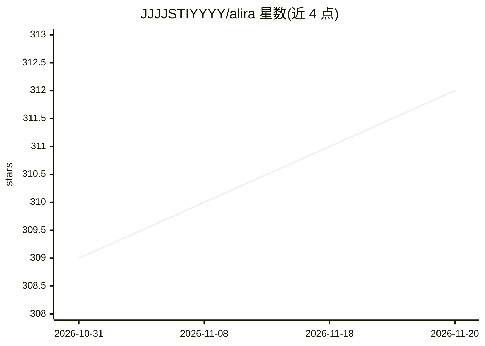

# JJJJSTIYYYY/alira

⭐ 312 · Python · GPL-3.0 · 推送 2026-11-15 · [GitHub](https://github.com/JJJJSTIYYYY/alira) · 个人维护 · 中文 README

**构建 AI Agent 应用的模块化运行时框架**

Alira 是面向 AI Agent 应用开发的 Python 运行时：提供模型调用、上下文管理、工具接入（函数工具与 MCP）与消息持久化能力。核心机制是模块化运行——按需选择启动模块并自动加载前置模块，依赖在部署时显式安装、启动时不联网；Agent 编排基于 Apixis 的事件与图执行能力；支持从 ZIP、GitHub、清单文件安装模块。需 Python 3.12+ 与 uv，从源码启动，PyPI 发行包名为 alira-harness。README 声明项目处于早期开发阶段。

## 筛选速览

| 维度 | 判定 | 备注 |
|---|---|---|
| AI 角色 | `ai-ecosystem` | LLM/agent 周边工具 |
| 许可风险 | `viral` | GPL-3.0 |
| 部署形态 | `library` | 以包/库形式分发 |
| 模型依赖 | — | README 未给出锁定关系 |
| 硬件要求 | — | 无带数字的原话,不猜 |
| 安装摩擦 | `low` | 无编译、无系统依赖或容器化 |
| 成熟度 | `idea` | |

## 能力要点

- 模块化运行：按需选择启动模块，自动加载前置模块
- 工具接入支持函数工具与 MCP
- 基于 Apixis 事件与图执行的 Agent 编排
- 上下文管理、消息持久化与可选 SQLite 向量检索

## 适用场景

- 搭建需要模型调用与工具接入的 AI Agent 应用
- 以模块组合方式管理不同场景的 Agent 运行时
- 为 Agent 应用集成消息存储与上下文管理

## 场景标签

`Agent 框架` · 领域:Agent 开发

## 证据(README 行号)

> L11: Alira 为构建 AI Agent 应用提供模型调用、上下文管理、工具接入与消息存储能力。
> L19: - **Agent 编排**：基于 Apixis 的事件与图执行能力，组织 Agent 的执行流程。

## 星数曲线

2026-10-31 309 → 2026-11-20 312（+3）

---
*卡片 v1 · prompt 1.4 · 生成 2026-11-17 · 置信度 mid · 依据 README sha `c69abd76315b` · [字段定义](../../DATASET.md)*
