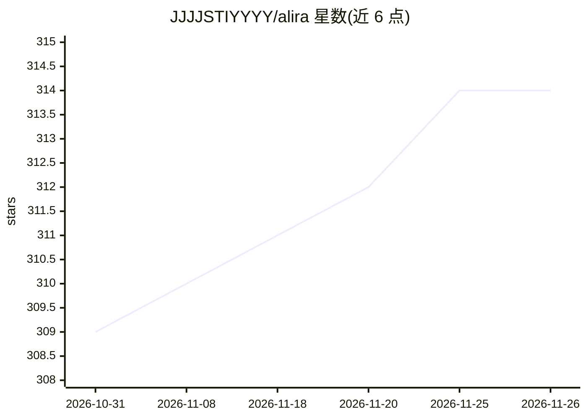

# JJJJSTIYYYY/alira

⭐ 314 · Python · GPL-3.0 · 推送 2026-11-24 · [GitHub](https://github.com/JJJJSTIYYYY/alira) · 个人维护 · 中文 README

**给开发者用的 AI Agent 应用模块化运行时框架**

Alira 以模块化 harness 形式提供构建 AI Agent 应用所需的模型调用、上下文管理、工具接入与消息存储能力；基于 Apixis 的事件与图执行能力组织 Agent 流程，支持函数工具与 MCP 扩展，提供可选 SQLite 向量检索。通过 uv 从源码启动，CLI 覆盖模块添加、安装（本地 ZIP 或 GitHub 仓库）、批量清单安装与依赖同步。README 声明项目处于早期开发阶段，接口与功能仍在演进，许可证为 GPL v3.0。

## 筛选速览

| 维度 | 判定 | 备注 |
|---|---|---|
| AI 角色 | `ai-ecosystem` | LLM/agent 周边工具 |
| 许可风险 | `viral` | GPL-3.0 |
| 部署形态 | `library` | 以包/库形式分发 |
| 模型依赖 | — | README 未给出锁定关系 |
| 硬件要求 | — | 无带数字的原话,不猜 |
| 安装摩擦 | `low` | 无编译、无系统依赖或容器化 |
| 成熟度 | `idea` | |

## 能力要点

- 模块化运行时：按需选择启动模块并自动加载前置模块
- 基于 Apixis 的事件与图执行编排 Agent 流程
- 支持函数工具与 MCP 工具接入
- CLI 支持从 GitHub 仓库与批量清单安装模块并统一同步依赖

## 适用场景

- 组合模块快速搭建具备工具调用与消息存储的 Agent 应用
- 以 MCP 或函数工具扩展 Agent 能力
- 按模块管理多应用场景的依赖与部署

## 场景标签

`Agent 框架` `模型网关` · 领域:Agent 开发

## 证据(README 行号)

> L11: Alira 为构建 AI Agent 应用提供模型调用、上下文管理、工具接入与消息存储能力。
> L19: - **Agent 编排**：基于 Apixis 的事件与图执行能力，组织 Agent 的执行流程。

## 星数曲线

2026-10-31 309 → 2026-11-26 314（+5）

---
*卡片 v1 · prompt 1.4 · 生成 2026-11-25 · 置信度 high · 依据 README sha `a382bb650a06` · [字段定义](../../DATASET.md)*
