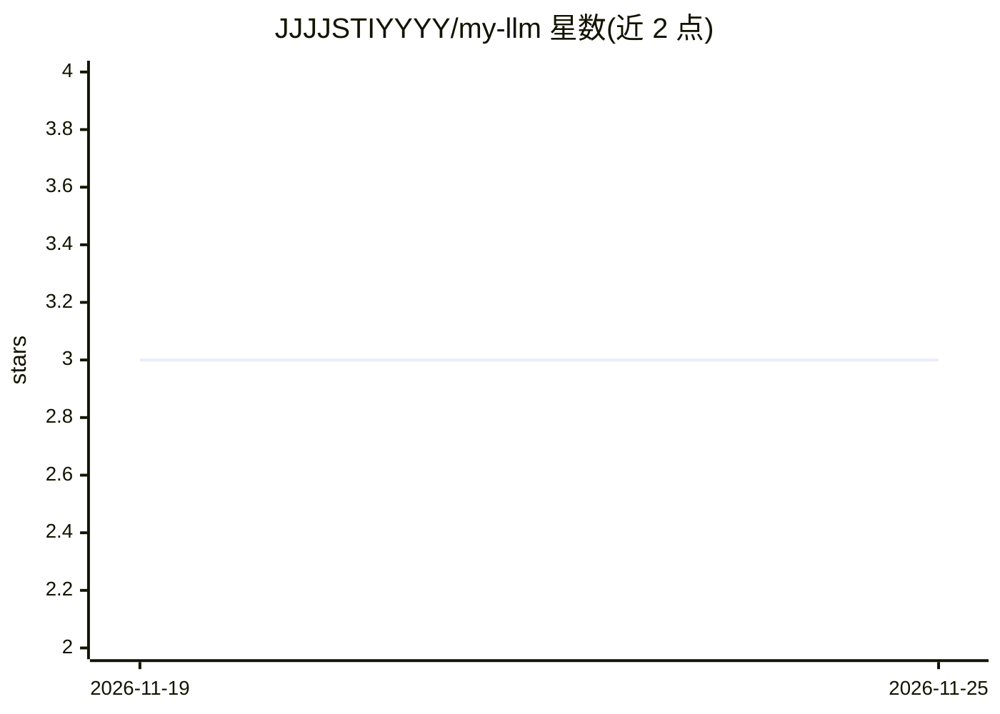

# JJJJSTIYYYY/my-llm

⭐ 3 · Python · Apache-2.0 · 推送 2026-11-22 · [GitHub](https://github.com/JJJJSTIYYYY/my-llm) · 个人维护 · 中文 README

**LLM 协议适配库：一种协议调用另一种协议的 API**

my-llm-py 是 Python 异步 LLM 协议适配库，支持 OpenAI Chat、OpenAI Responses、Anthropic 三种协议自由组合：以任一协议输入，调用另一协议的上游 API，消息、工具和流事件随协议一并转换。标准协议直接转换，非标准差异通过 Profile 配置兼容；已支持内容无法表达时抛 SemanticLossError，可选 ignore 或 hook 补偿。面向需要在更换上游 API 时保持业务层协议不变的开发者，提供 MyCodec 离线格式转换与自定义协议注册扩展机制，需 Python 3.12+。

## 筛选速览

| 维度 | 判定 | 备注 |
|---|---|---|
| AI 角色 | `ai-ecosystem` | LLM/agent 周边工具 |
| 许可风险 | `permissive` | Apache-2.0 |
| 部署形态 | `library` | 以包/库形式分发 |
| 模型依赖 | — | README 未给出锁定关系 |
| 硬件要求 | — | 无带数字的原话,不猜 |
| 安装摩擦 | `low` | 无编译、无系统依赖或容器化 |
| 成熟度 | — | 结构信号不足 |

## 能力要点

- 三种协议（OpenAI Chat/Responses、Anthropic）输入输出与上游任意组合
- 消息、工具与流事件一并转换，工具调用流式参数自动组装
- MyCodec 无需 API 密钥即可离线转换消息/工具/流事件
- 通过 MyCodec.register 实现四个抽象基类扩展新协议

## 适用场景

- 更换上游 LLM API 而业务层保持原有 OpenAI 协议收发
- 以 Anthropic 协议访问 OpenAI 兼容服务或反之
- 离线转换消息、工具与流事件格式做协议调试

## 场景标签

`模型网关` · 领域:Agent 开发

## 证据(README 行号)

> L9: **通用的 LLM Provider 协议适配器**
> L11: my-llm-py 是一个 Python 异步 LLM 协议适配库，支持 OpenAI Chat、OpenAI Responses、Anthropic 三种协议自由组合。
> L13: **用一种协议请求另一种协议的 API，按输入协议返回结果。标准协议直接转换，非标准协议通过配置兼容。**

## 星数曲线

2026-11-19 3 → 2026-11-25 3（+0）

---
*卡片 v1 · prompt 1.4 · 生成 2026-11-22 · 置信度 high · 依据 README sha `0d510c83463f` · [字段定义](../../DATASET.md)*
