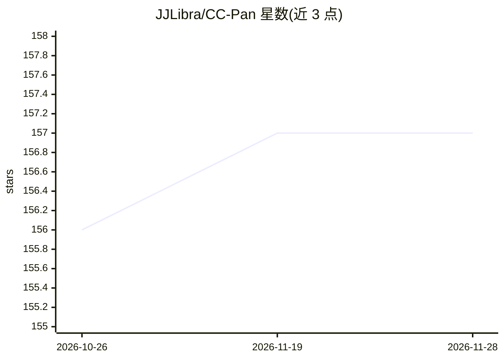

# JJLibra/CC-Pan

⭐ 157 · Python · MIT · 推送 2026-11-03 · [GitHub](https://github.com/JJLibra/CC-Pan) · [官网](https://salad-pan.github.io) · 组织维护

**基于通道压缩扩散的全色锐化模型，生成高分辨率多光谱影像**

TMM 2026 论文的官方实现：以 PAN 与低分辨率多光谱影像对为输入，微调预训练扩散模型生成高分辨率多光谱影像。采用两阶段训练——先预训练 1 通道 Band-VAE，再在 Band-VAE 潜空间中进行潜扩散加轻量双分支适配器微调。仓库提供训练/推理脚本、两阶段权重下载、PanCollection 格式 H5 数据集准备说明及 Gradio 本地演示，基于 PyTorch、diffusers 与 Accelerate，面向科研复现。

## 筛选速览

| 维度 | 判定 | 备注 |
|---|---|---|
| AI 角色 | `ai-native` | 本体是模型或模型工具 |
| 许可风险 | `permissive` | MIT |
| 部署形态 | `None` |  |
| 模型依赖 | — | README 未给出锁定关系 |
| 硬件要求 | — | 无带数字的原话,不猜 |
| 安装摩擦 | `medium` | 含编译或系统依赖之一 |
| 成熟度 | — | 结构信号不足 |

## 能力要点

- 两阶段训练流程：Band-VAE 预训练 + 潜空间扩散与适配器微调
- 提供训练、离线推理、评估指标输出（H5/RGB/JSONL）的完整脚本
- 附带 Gradio 本地交互演示（app.py）
- 提供 WV3/QB/GF2 三个数据集的基准评测结果表

## 适用场景

- 复现论文中的全色锐化基准评测流程
- 在自有的遥感 PAN/LRMS 数据上训练或微调模型
- 加载预训练权重对 H5 数据集做离线推理与指标评估

## 场景标签

`微调` `模型评测` `图像生成` `科研工具` · 领域:评测与运维

## 证据(README 行号)

> L32:  Given a PAN–LRMS image pair, CC-Pan fine-tunes a pre-trained diffusion model to generate a HRMS image.
> L34: CC-Pan is a diffusion-based pan-sharpening framework that compresses multispectral channels into a compact latent s
> L55: 4. Launch Stage-I VAE training, then Stage-II diffusion training, and finally run `inference.py` for evaluation.

## 星数曲线

2026-10-26 156 → 2026-11-28 157（+1）

---
*卡片 v1 · prompt 1.4 · 生成 2026-11-27 · 置信度 high · 依据 README sha `77a15be3e66d` · [字段定义](../../DATASET.md)*
