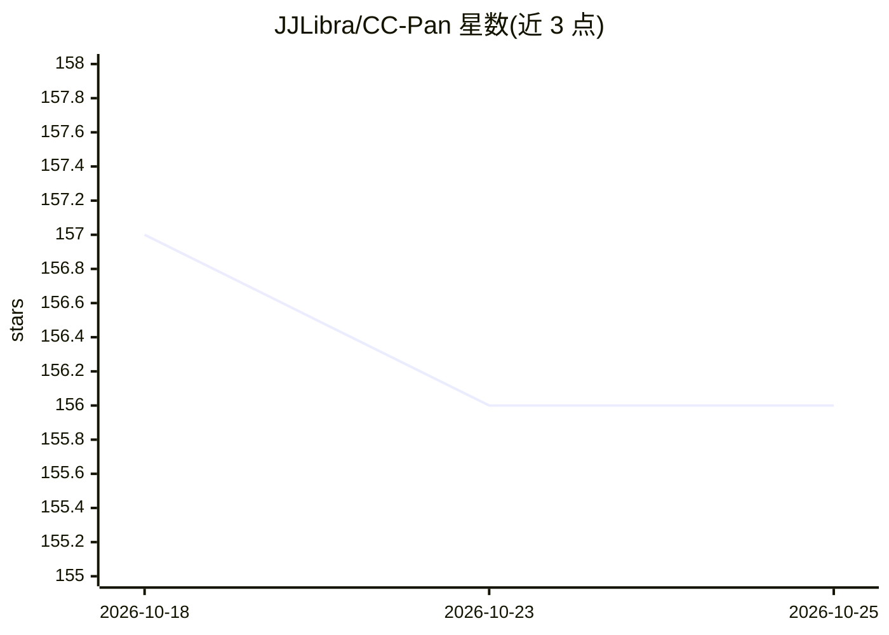

# JJLibra/CC-Pan

⭐ 156 · Python · MIT · 推送 2026-05-21 · [GitHub](https://github.com/JJLibra/CC-Pan) · [官网](https://salad-pan.github.io) · 组织维护

**遥感全色锐化：扩散模型微调生成高分辨率多光谱影像**

论文官方实现：输入 PAN 与低分辨率多光谱图像对，通过两阶段流程（1 通道 Band-VAE 预训练 + 潜空间扩散与轻量双分支 adapter 微调）重建高分辨率多光谱影像。提供训练入口 train_vae.py/train_diffusion.py、离线推理 inference.py 与 Gradio 交互演示，需本地存放 Stable Diffusion v1-5 基座、两阶段权重与 PanCollection 风格 H5 数据集（GF2/QB/WV3）。README 声明代码即将发布；训练在 8 张 RTX 4090 上约 1-2 天（40k-50k 步，fp16）。

## 筛选速览

| 维度 | 判定 | 备注 |
|---|---|---|
| AI 角色 | `ai-native` | 本体是模型或模型工具 |
| 许可风险 | `permissive` | MIT |
| 部署形态 | `None` |  |
| 模型依赖 | — | README 未给出锁定关系 |
| 硬件要求 | — | 无带数字的原话,不猜 |
| 安装摩擦 | `medium` | 含编译或系统依赖之一 |
| 成熟度 | `idea` | |

## 能力要点

- 两阶段训练：Band-VAE 预训练 + 潜空间扩散与双分支 adapter 微调
- 提供离线推理脚本与 Gradio 交互演示
- 支持 GF2/QB/WV3 传感器数据，采样 20 步 NFE

## 适用场景

- 对遥感影像做全色锐化生成高分辨率多光谱图像
- 在 PanCollection 数据集上复现论文训练与评测
- 通过 Gradio 演示交互式体验模型输出

## 场景标签

`图像生成` `微调` · 领域:内容生成

## 证据(README 行号)

> L31:  Given a PAN–LRMS image pair, CC-Pan fine-tunes a pre-trained diffusion model to generate a HRMS image.
> L33: CC-Pan is a diffusion-based pan-sharpening framework that compresses multispectral channels into a compact latent s

## 星数曲线

2026-10-18 157 → 2026-10-25 156（-1）

---
*卡片 v1 · prompt 1.4 · 生成 2026-10-22 · 置信度 high · 依据 README sha `b2a6a39e0da2` · [字段定义](../../DATASET.md)*
