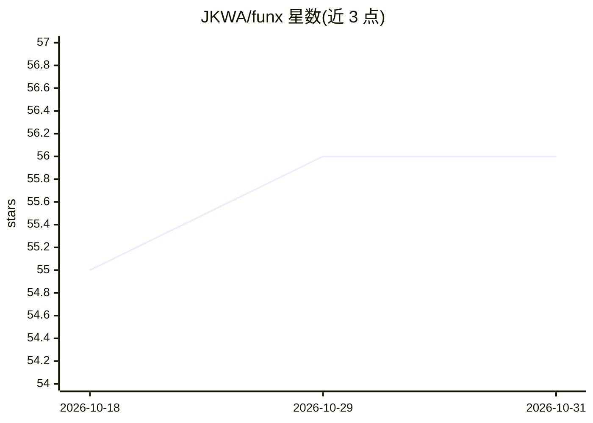

# JKWA/funx

⭐ 56 · Elixir · MIT · 推送 2026-05-29 · [GitHub](https://github.com/JKWA/funx) · [官网](https://www.funxlib.com) · 个人维护

**Elixir 函数式编程模式库，附面向 LLM 辅助开发的用法规则**

面向 Elixir 开发者的组合式函数式编程库，以 Hex 包发布。提供 Eq/Ord 相等与排序协议、Maybe/Either/Reader 等 Monad、Lens/Prism 等 Optics、Monoid、谓词组合子、声明式 Validate 校验、Foldable/Filterable 以及与 {:ok, value} 结果元组的互操作，各模块配套 DSL 与格式化规则。0.8 版本；README 声明处于 Beta 阶段、1.0 前 API 可能变化，0.6.0 曾发生模块重组的破坏性变更。库内嵌为 LLM 辅助开发工作流编写的用法规则（usage rules），作为 API 文档之外的补充。

## 筛选速览

| 维度 | 判定 | 备注 |
|---|---|---|
| AI 角色 | `ai-enhanced` | 去掉 AI 部分产品仍成立 |
| 许可风险 | `permissive` | MIT |
| 部署形态 | `None` |  |
| 模型依赖 | — | README 未给出锁定关系 |
| 硬件要求 | — | 无带数字的原话,不猜 |
| 安装摩擦 | `low` | 无编译、无系统依赖或容器化 |
| 成熟度 | `idea` | |

## 能力要点

- Eq/Ord 协议与 DSL，支持 optics、函数与自定义比较器
- Identity/Maybe/Either/Effect/Reader/Writer 六种 Monad 与 Either DSL
- Lens/Prism/Traversal/Iso 可组合 Optics
- 声明式 Validate 校验，错误累积收集

## 适用场景

- 在 Elixir 项目中用 Maybe/Either 结构化处理可选值与错误
- 声明式定义数据校验规则并累积错误
- 为 LLM 辅助编码工作流提供函数式模式的用法规则

## 场景标签

 · 领域:编程库/函数式编程

## 证据(README 行号)

> L6: # Funx - Functional Programming Patterns for Elixir
> L60: Funx includes embedded **usage rules** in addition to API documentation.
> L61: They are written for development workflows assisted by LLMs.

## 星数曲线

2026-10-18 55 → 2026-10-31 56（+1）

---
*卡片 v1 · prompt 1.4 · 生成 2026-10-24 · 置信度 high · 依据 README sha `fbc111f82730` · [字段定义](../../DATASET.md)*
