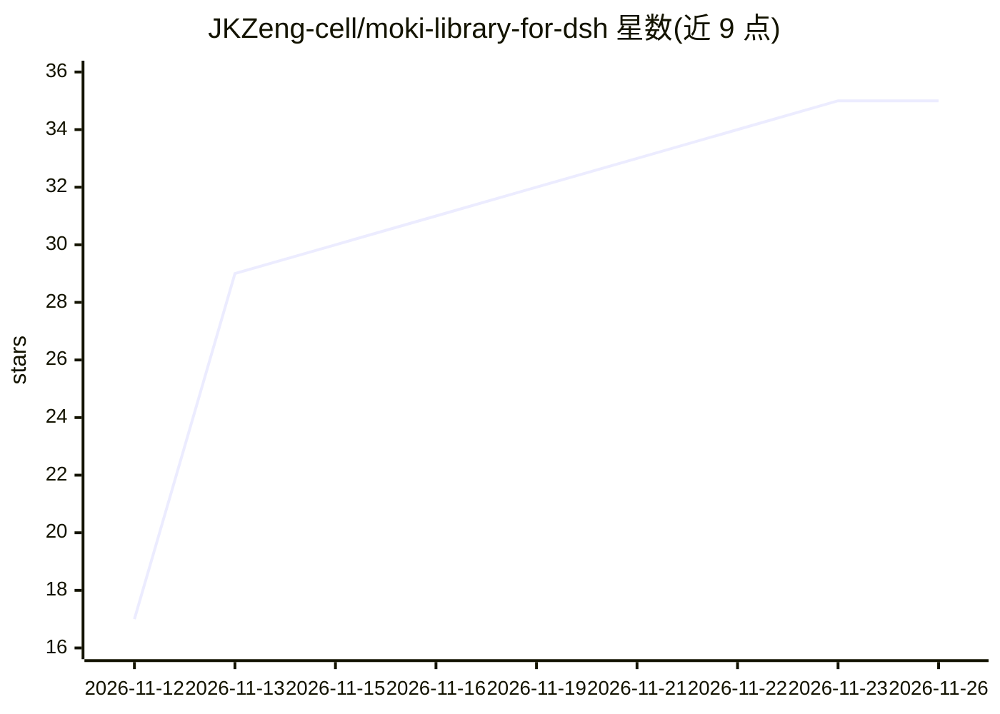

# JKZeng-cell/moki-library-for-dsh

⭐ 35 · JavaScript · MIT · 推送 2026-11-15 · [GitHub](https://github.com/JKZeng-cell/moki-library-for-dsh) · [官网](https://github.com/JKZeng-cell/moki-library-for-dsh#readme) · 个人维护 · 中文 README

**给 DeepSeek Harness 的本地文件库插件：文件管理与 AI 选区协同编辑**

DeepSeek Harness（DSH）桌面端的社区插件，在对话旁提供本地文件库：管理文件/文件夹/链接、虚拟文件夹与标签、多格式预览（图片、音视频、PDF、Office、压缩包、字体、3D 等），并支持 Word/Excel/PowerPoint 的隔离草稿编辑后回存。核心机制是选区协同：把文本偏移、表格区域、幻灯片对象、页码或图像区域连同精确位置传给 DSH，AI 编辑以高亮呈现，经 Accept/Discard 审查后保存。已测 Windows + DSH Desktop 0.2.2-rc.1，需 Node.js 22.19+，其他版本与系统待验证。

## 筛选速览

| 维度 | 判定 | 备注 |
|---|---|---|
| AI 角色 | `ai-ecosystem` | LLM/agent 周边工具 |
| 许可风险 | `permissive` | MIT |
| 部署形态 | `None` |  |
| 模型依赖 | locked-api |  |
| 硬件要求 | — | 无带数字的原话,不猜 |
| 安装摩擦 | `medium` | 含编译或系统依赖之一 |
| 成熟度 | `idea` | |

## 能力要点

- 选区引用携带精确位置（文本偏移/Sheet 区域/幻灯片对象/页码/图像区域）传给 DSH
- Word/Excel/PPT 隔离草稿编辑，AI 编辑高亮并经 Accept/Discard 审查后保存
- 多格式内置预览路径，含压缩包、字体、常见 3D 格式
- Alt+D 与选区旁鲸鱼按钮唤起带位置引用的快速对话输入

## 适用场景

- 在 DSH 对话旁管理项目文档并直接预览
- 选中表格区域或文档段落让 AI 修改并审查后保存
- 把 DSH 生成的任务文件自动映射进文件库整理

## 场景标签

`知识库管理` `AI 写作` · 领域:内容生成

## 证据(README 行号)

> L9: MOKI Library is a community plugin for **DeepSeek Harness (DSH)**. It brings a local file library, multi-format prev
> L28: - **Collaborate on a precise selection.** Pass text offsets, sheet/range addresses, slide objects, page numbers or 
> L31: - **Keep context compact.** Selection references carry bounded content and exact locations. Supported edits use `co

## 星数曲线

2026-11-12 17 → 2026-11-26 35（+18）

---
*卡片 v1 · prompt 1.4 · 生成 2026-11-18 · 置信度 high · 依据 README sha `f7f9c8641579` · [字段定义](../../DATASET.md)*
