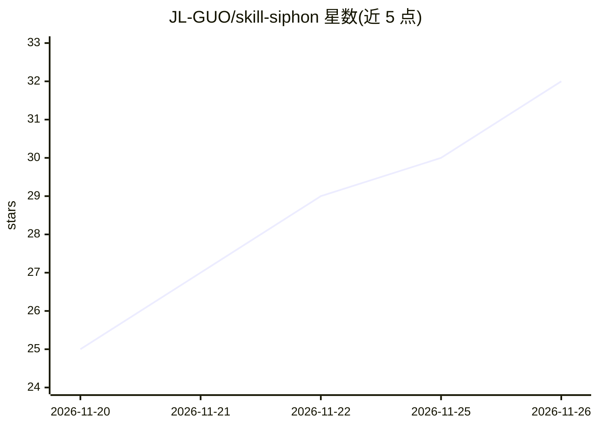

# JL-GUO/skill-siphon

⭐ 32 · MIT · 推送 2026-11-25 · [GitHub](https://github.com/JL-GUO/skill-siphon) · 个人维护 · 中文 README

**把高星 Agent Skill 提炼为可学习资料的技能工具**

本身是一个遵循 Agent Skills 协议（SKILL.md + references/）的技能：给定学习领域时搜索并列出 3–5 个候选 skill 供选择，给定具体 skill 时直接深读源文件，沿引用追到经验成立处，凝练步骤背后的做法、取舍与例外，默认生成学习指南、上手实践、来源与边界三份 Markdown 到指定目录。明确不执行被分析 skill 的安装或外部操作指令，输出保留原作者署名与许可证。安装方式为 git clone 后放入应用的 skills 目录。

## 筛选速览

| 维度 | 判定 | 备注 |
|---|---|---|
| AI 角色 | `ai-native` | 本体是模型或模型工具 |
| 许可风险 | `permissive` | MIT |
| 部署形态 | `None` |  |
| 模型依赖 | — | README 未给出锁定关系 |
| 硬件要求 | — | 无带数字的原话,不猜 |
| 安装摩擦 | `low` | 无编译、无系统依赖或容器化 |
| 成熟度 | — | 结构信号不足 |

## 能力要点

- 给定领域时列出 3–5 个候选 skill 并说明选择理由与局限
- 生成学习指南、上手实践、来源与边界三份 Markdown 资料
- 兼容 WorkBuddy、Claude Code、Codex、Cursor、Gemini CLI 等支持 Agent Skills 协议的 runtime
- 分析技能源时不执行其安装与外部操作指令

## 适用场景

- 入门新领域时先找并研读该方向的高星 skill
- 把某个 skill 里的经验转成新手能学、能练的资料
- 为团队沉淀 skill 中可迁移的做法与判断标准

## 场景标签

 · 领域:AI 工具/知识提炼

## 证据(README 行号)

> L22: **吸星大法**是一枚 Agent Skill：把优秀 skill 里可学习的工作经验吸纳进来，凝练成你**能理解、能练习、能用上**的学习资料——学会这项工作怎样做、为何这样做、怎样判断好坏，以及情况变化时如何调整。判断力，包含
> L88: 基于开放的 **Agent Skills** 协议（`SKILL.md` + `references/`），可在 WorkBuddy、Claude Code、Codex、Cursor、Gemini CLI、OpenCode、Dee

## 星数曲线

2026-11-20 25 → 2026-11-26 32（+7）

---
*卡片 v1 · prompt 1.4 · 生成 2026-11-20 · 置信度 high · 依据 README sha `743c1315f29a` · [字段定义](../../DATASET.md)*
