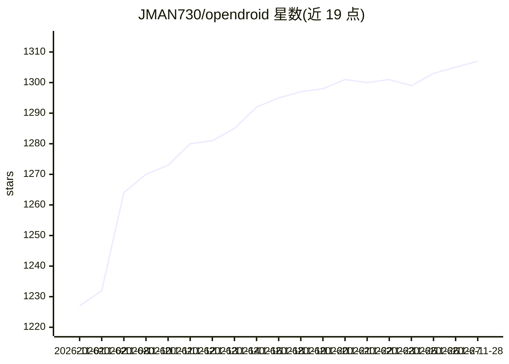

# JMAN730/opendroid

⭐ 1,307 · Kotlin · NOASSERTION · 推送 2026-11-25 · [GitHub](https://github.com/JMAN730/opendroid) · [官网](https://jman730.github.io/opendroid/) · 个人维护

**Android 端自主规划 AI Agent，用 LLM 与无障碍服务自动化操作手机**

运行在 Android 手机上的自主 AI Agent 应用：将用户的自然语言指令分解为多个步骤并逐一执行、验证、失败时重新规划。通过 Android Accessibility API 驱动 UI 自动化，覆盖系统设置、消息、通话、日程、导航、支付等操作；截图送入视觉 LLM 做屏幕理解，内置 LiteRT-LM 本地模型管理器支持下载/导入本地模型，另含唤醒词语音接口与个人知识图谱记忆。以 Kotlin/Jetpack Compose 构建的 Android 应用形式分发，需从源码构建并授予无障碍等多项权限。

## 筛选速览

| 维度 | 判定 | 备注 |
|---|---|---|
| AI 角色 | `ai-native` | 本体是模型或模型工具 |
| 许可风险 | `none` | NOASSERTION |
| 部署形态 | `None` |  |
| 模型依赖 | local-ok | 支持本地模型 |
| 硬件要求 | — | 无带数字的原话,不猜 |
| 安装摩擦 | `medium` | 含编译或系统依赖之一 |
| 成熟度 | — | 结构信号不足 |

## 能力要点

- 自主规划引擎：步骤分解、依赖跟踪、失败重规划
- 13 家 LLM 提供商接入与自动故障转移链
- 基于 Accessibility API 的全设备控制与屏幕理解
- LiteRT-LM 本地模型管理器，支持 Hugging Face 门控模型下载与离线导入

## 适用场景

- 用一句话让手机完成查天气、发消息、设闹钟的组合任务
- 挖掘每日重复的应用使用序列并一键自动化
- 完全离线场景下配合本地模型运行语音指令

## 场景标签

`GUI 自动化` · 领域:效率与自动化

## 证据(README 行号)

> L24: OpenDroid isn't just another chatbot. It's a **fully autonomous AI agent** that lives on your Android phone and act
> L116: ## 🔌 Supported LLM Providers

## 星数曲线

2026-11-01 1,227 → 2026-11-28 1,307（+80）

---
*卡片 v1 · prompt 1.4 · 生成 2026-11-23 · 置信度 high · 依据 README sha `4c4071f0302d` · [字段定义](../../DATASET.md)*
