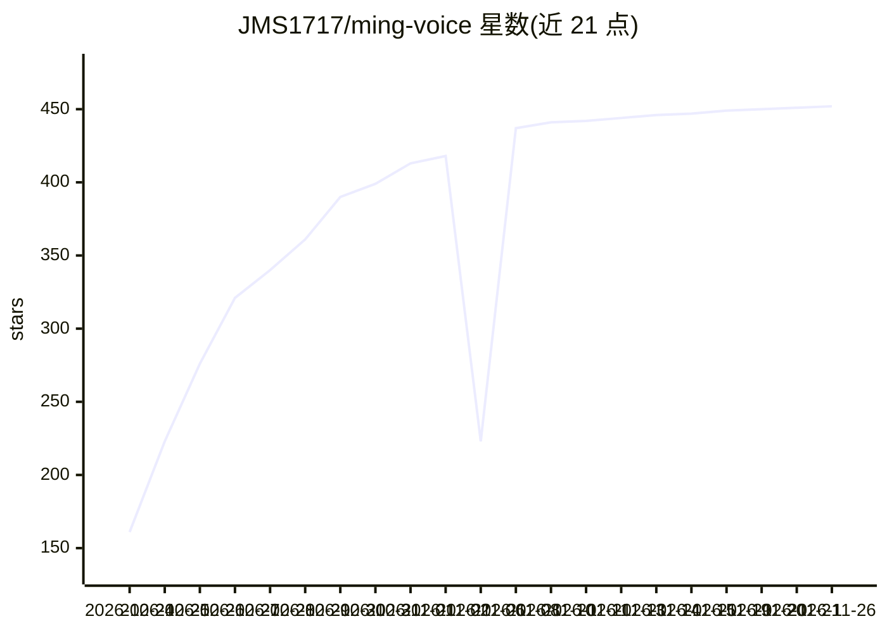

# JMS1717/ming-voice

⭐ 452 · Python · MIT · 推送 2026-11-18 · [GitHub](https://github.com/JMS1717/ming-voice) · 个人维护

**本地低延迟语音助手：说话即答，全程音频不出机器**

将 inclusionAI/Ming-3.0-audio-tiny 语音到语音模型包装为可长期运行的本地语音助手，在 AMD Radeon（NVIDIA 为实验性）GPU 上以约 0.23 秒延迟出声回答。内置 Smart Turn v3 轮次检测、可打断、唤醒词、断点续话，提供网页搜索、天气、计时器、清单记忆、Home Assistant 与 Jellyfin 控制，支持通过 Wyoming 协议接入 Home Assistant Assist。提供 OpenAI 兼容 API、语音克隆、中英文对话；默认模型约 20 GB，需 16 GB+ 显存的 GPU。

## 筛选速览

| 维度 | 判定 | 备注 |
|---|---|---|
| AI 角色 | `ai-native` | 本体是模型或模型工具 |
| 许可风险 | `permissive` | MIT |
| 部署形态 | `self-host` | docker 或自建部署 |
| 模型依赖 | — | README 未给出锁定关系 |
| 硬件要求 | `gpu-8g` | |
| 安装摩擦 | `low` | 无编译、无系统依赖或容器化 |
| 成熟度 | — | 结构信号不足 |

## 能力要点

- 语音到语音全本地运行，端到端首音延迟约 0.23 秒
- Smart Turn v3 轮次检测与随时打断
- Home Assistant 全屋控制（灯、锁、温控、车辆等）与 Wyoming 接入
- OpenAI 兼容 API 与 5–15 秒样本语音克隆

## 适用场景

- 在家用语音控制智能家居与查询天气
- 需要音频不出本机的隐私语音助手
- 手机通过家庭网络使用同一助手
- 为 Home Assistant Voice PE 提供本地语音后端

## 场景标签

`语音 Agent` · 领域:对话与助手

## 证据(README 行号)

> L3: **A fully local, real-time voice assistant for AMD Radeon GPUs (NVIDIA experimental), on Linux or Windows.**
> L13: Ming Voice turns inclusionAI/Ming-3.0-audio-tiny, a
> L14: speech-to-speech model, into an assistant you can leave running at home. It hears you, decides when you've

## 星数曲线

2026-10-24 161 → 2026-11-26 452（+291）

---
*卡片 v1 · prompt 1.4 · 生成 2026-11-25 · 置信度 mid · 依据 README sha `72f4b5d6c636` · [字段定义](../../DATASET.md)*
