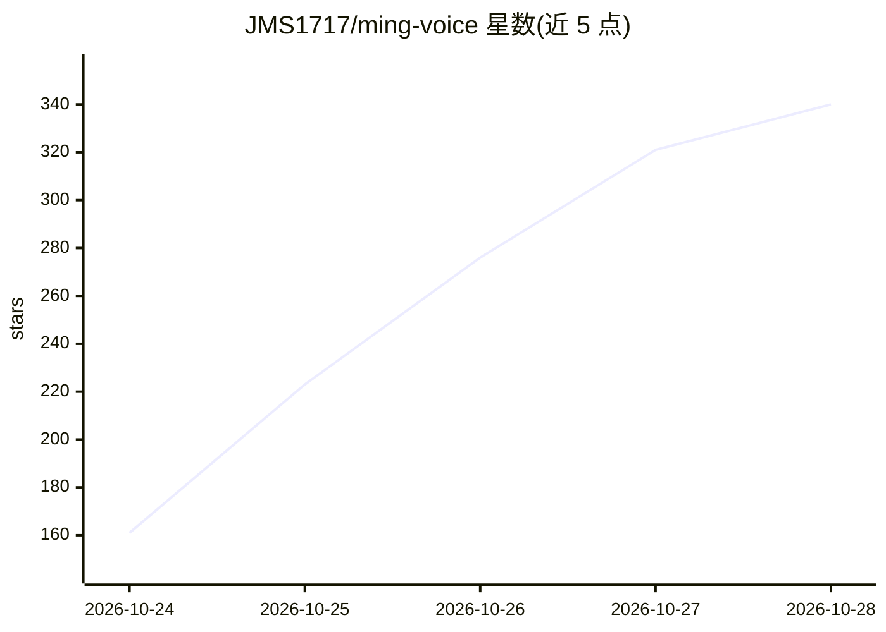

# JMS1717/ming-voice

⭐ 361 · Python · MIT · 推送 2026-10-26 · [GitHub](https://github.com/JMS1717/ming-voice) · 个人维护 · 中文 README

**AMD/NVIDIA GPU 上本地运行的实时语音助手**

基于 inclusionAI/Ming-3.0-audio-tiny 语音到语音模型构建的本地语音助手，面向有 16GB+ 显存 GPU 的家庭用户。用户说话后约 0.23 秒得到语音回答，全程在本机 GPU 上推理，音频不出机器。内置 Smart Turn v3 轮次检测、打断、唤醒词、7 种预置语音与 5-15 秒样本声音克隆，支持中英文。可联网调用天气/搜索工具（可关闭保持离线），并控制 Home Assistant 与 Jellyfin。提供 Linux 脚本与 Windows PowerShell 一键安装（WSL2），另提供 OpenAI 兼容 API 与手机 HTTPS 访问。限制：需 16GB+ 显存、约 30GB 磁盘；NVIDIA 支持标注为实验性。

## 筛选速览

| 维度 | 判定 | 备注 |
|---|---|---|
| AI 角色 | `ai-native` | 本体是模型或模型工具 |
| 许可风险 | `permissive` | MIT |
| 部署形态 | `library` | 以包/库形式分发 |
| 模型依赖 | — | README 未给出锁定关系 |
| 硬件要求 | `gpu-8g` | |
| 安装摩擦 | `medium` | 含编译或系统依赖之一 |
| 成熟度 | `idea` | |

## 能力要点

- 语音到语音全本地推理，回答延迟约 0.23 秒
- Smart Turn v3 轮次检测与随时打断、唤醒词模式
- 控制 Home Assistant/Jellyfin，风险操作需确认
- 5-15 秒样本声音克隆与 7 种预置语音
- Linux/Windows 一键安装脚本，OpenAI 兼容 API

## 适用场景

- 在家里常驻一台不联网的语音助手，问天气、设提醒、管购物清单
- 用语音控制 Home Assistant 灯光、温控、锁与扫地机
- 通过手机在家庭网络内远程使用同一助手

## 场景标签

`语音 Agent` `语音合成` · 领域:对话与助手

## 证据(README 行号)

> L13: Ming Voice turns inclusionAI/Ming-3.0-audio-tiny, a
> L14: speech-to-speech model, into an assistant you can leave running at home. It hears you, decides when you've
> L74: |Thinker (audio LLM, 9.3B MoE / 2.7B active)|~115 tokens/s; first token ~80 ms after a short spoken turn|

## 星数曲线

2026-10-24 161 → 2026-10-28 340（+179）

---
*卡片 v1 · prompt 1.4 · 生成 2026-10-23 · 置信度 mid · 依据 README sha `f99f7c14eb21` · [字段定义](../../DATASET.md)*
