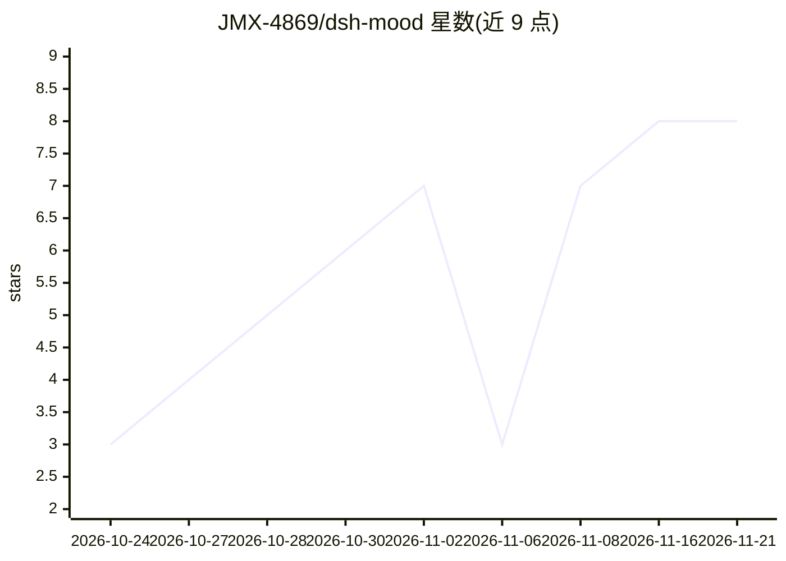

# JMX-4869/dsh-mood

⭐ 8 · JavaScript · MIT · 推送 2026-11-08 · [GitHub](https://github.com/JMX-4869/dsh-mood) · [官网](https://github.com/JMX-4869/dsh-mood#readme) · 个人维护 · 中文 README

**给 DeepSeek Harness 模型加 33 种心情系统的插件**

一个运行在 DeepSeek Harness（DSH）插件体系里的心情插件：33 种心情各持 0~100 数值，按关键词判定与每 3~6 小时周期判定更新，当前心情注入 systemPrompt 影响回复语气与思考内容。附带心情日记（每日 23:59 生成）、跨会话记忆、品味库、时事抓取（RSS/网页/视频抽帧）与可选主动开口。支持人设插件叠加共存，数据本地存储且位置可迁移。另提供手机版系统提示词版本。MIT 开源，未发布 npm registry，需经 DSH 插件面板/git/Release 包安装。

## 筛选速览

| 维度 | 判定 | 备注 |
|---|---|---|
| AI 角色 | `ai-native` | 本体是模型或模型工具 |
| 许可风险 | `permissive` | MIT |
| 部署形态 | `library` | 以包/库形式分发 |
| 模型依赖 | locked-api |  |
| 硬件要求 | — | 无带数字的原话,不猜 |
| 安装摩擦 | `low` | 无编译、无系统依赖或容器化 |
| 成熟度 | — | 结构信号不足 |

## 能力要点

- 33 种心情三层分类（基础/复合/当代），带防抖与混合态机制
- 心情每轮注入提示词，影响语气与思考内心话，不影响任务判断
- 内置 DISTRESS 词表，命中真实痛苦信号时硬性收起情绪表演
- 同一套规则提供桌面插件与手机版提示词两种形态

## 适用场景

- 给 DSH 里的 DeepSeek 对话加情绪层与人格陪伴感
- 跨会话保留心情日记与品味库做长期陪伴
- 在手机版 DeepSeek 上直接贴提示词复用同一套心情规则

## 场景标签

`聊天机器人` `AI 助手` · 领域:对话与助手

## 证据(README 行号)

> L3: 给 **DeepSeek Harness**（DSH）里的模型加一套**心情系统** —— 33 种心情各自持有数值，随对话和时间缓慢变化，注入提示词，影响**回复的语气**和**深度思考里的内心话**。
> L43: ## 安装
> L174: 手机上的 DeepSeek 跑不了 DSH 插件 —— 但**同一套规则可以直接贴进系统提示词**。

## 星数曲线

2026-10-24 3 → 2026-11-21 8（+5）

---
*卡片 v1 · prompt 1.4 · 生成 2026-11-20 · 置信度 high · 依据 README sha `bd4ec8a17e27` · [字段定义](../../DATASET.md)*
