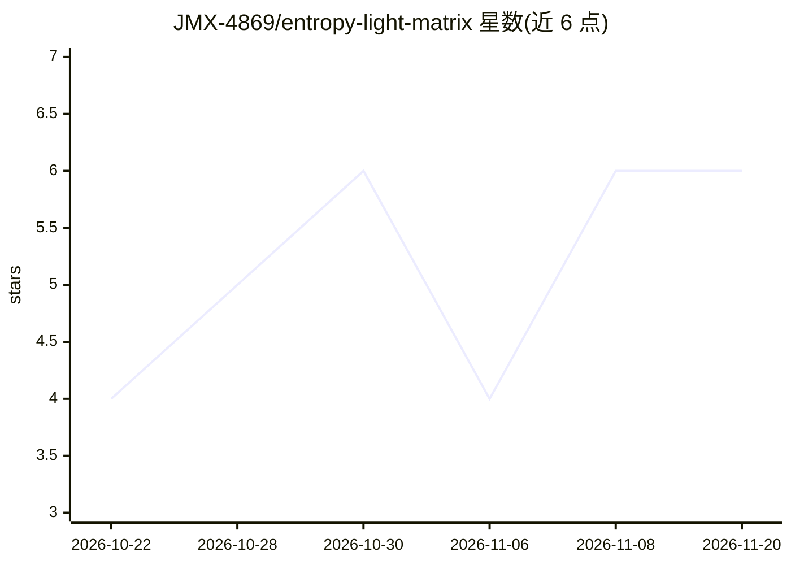

# JMX-4869/entropy-light-matrix

⭐ 6 · Python · MIT · 推送 2026-11-14 · [GitHub](https://github.com/JMX-4869/entropy-light-matrix) · [官网](https://jmx-4869.github.io/entropy-light-matrix/) · 个人维护 · 中文 README

**给《群星》玩家的模组冲突诊断与智能排序启动器**

面向《群星》(Stellaris) 的桌面工具：解析 Clausewitz 脚本语法树做 6 类冲突检测（文件覆盖、语义重定义、本地化键、依赖、版本兼容、文件完整性），分层排序求解最优加载顺序并写回 launcher-v2.sqlite 与 dlc_load.json；内置本地规则引擎与 AI 双引擎生成兼容补丁，崩溃日志翻译成中文并附成因注释，后台监控 error.log、内存趋势与崩溃目录。本地补丁模式不联网、不用 API key。Windows 安装包或直接运行打包程序，源码需 Python 3.10+ 与 Edge WebView2。

## 筛选速览

| 维度 | 判定 | 备注 |
|---|---|---|
| AI 角色 | `ai-enhanced` | 去掉 AI 部分产品仍成立 |
| 许可风险 | `permissive` | MIT |
| 部署形态 | `desktop` | 安装包/桌面程序 |
| 模型依赖 | local-ok | 支持本地模型 |
| 硬件要求 | — | 无带数字的原话,不猜 |
| 安装摩擦 | `low` | 无编译、无系统依赖或容器化 |
| 成熟度 | — | 结构信号不足 |

## 能力要点

- 解析 Clausewitz 语法树的 6 类冲突检测与拓扑求解最优加载顺序
- 本地规则 + AI 双引擎补丁生成，输出带置信度与依据的草稿
- 崩溃日志中文翻译、分组注释并生成 Markdown/HTML 诊断报告
- 写盘前暂存确认、自动备份，模组开关与关停决定权保留给用户

## 适用场景

- 装了几十个模组后排查功能失效与启动报错
- 一键求解模组加载顺序并写入游戏配置
- 崩溃后把英文 error.log 翻译成可读的中文报告
- 不配 API key 时用本地规则批量生成兼容补丁

## 场景标签

 · 领域:游戏/模组工具

## 证据(README 行号)

> L3: 一个面向《群星》(Stellaris) 的**模组冲突诊断 + 智能排序启动器**。
> L94: ### 5. 接入 AI 自动做兼容补丁
> L433: ## 本地自动补丁（不联网、不用 API）

## 星数曲线

2026-10-22 4 → 2026-11-20 6（+2）

---
*卡片 v1 · prompt 1.4 · 生成 2026-11-20 · 置信度 mid · 依据 README sha `83868e6e0cdf` · [字段定义](../../DATASET.md)*
