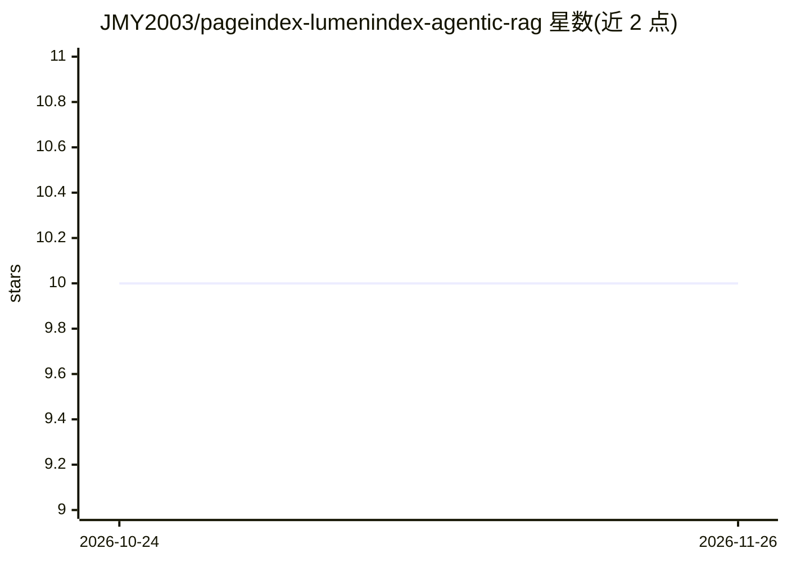

# JMY2003/pageindex-lumenindex-agentic-rag

⭐ 10 · Python · MIT · 推送 2026-07-08 · [GitHub](https://github.com/JMY2003/pageindex-lumenindex-agentic-rag) · 个人维护 · 中文 README

**自托管文档问答工作区：基于文档结构推理的无向量 RAG**

以 FastAPI 实现的 PageIndex 架构文档问答系统：通过对大纲、页码范围、章节路径与词法证据的推理完成检索，不依赖嵌入模型或向量数据库。支持 PDF、DOC/DOCX、Markdown 多文档同会话问答，提供本地账户与用户隔离、ChatGPT 式持久会话、长上下文自动压缩归档、Pydantic 校验的结构化 LLM 输出，以及子进程索引与失败恢复。可通过 Conda 或 Docker Compose 部署，LLM 经 OpenAI 兼容端点配置（如 Qwen/DashScope）。

## 筛选速览

| 维度 | 判定 | 备注 |
|---|---|---|
| AI 角色 | `ai-native` | 本体是模型或模型工具 |
| 许可风险 | `permissive` | MIT |
| 部署形态 | `self-host` | docker 或自建部署 |
| 模型依赖 | — | README 未给出锁定关系 |
| 硬件要求 | — | 无带数字的原话,不猜 |
| 安装摩擦 | `low` | 无编译、无系统依赖或容器化 |
| 成熟度 | — | 结构信号不足 |

## 能力要点

- 无向量 RAG：基于文档层级结构与 ReAct 工具调用检索证据
- 多文档同会话问答（PDF/DOCX/Markdown），回答带文档引用
- 持久会话、上下文自动压缩与归档、用户资产隔离
- 子进程索引、取消、缓存版本与重复检测

## 适用场景

- 自托管私有文档库的问答工作区
- 对长 PDF 报告做多文档交叉提问
- 给团队提供带账户隔离的文档检索服务

## 场景标签

`文档问答` `RAG` · 领域:知识与检索

## 证据(README 行号)

> L3: **A production-ready PageIndex-inspired document QA system for vectorless RAG, long-document retrieval, and multi-us
> L11: - **Vectorless RAG over document structure**: uses outlines, page ranges, section paths, lexical evidence, and agen
> L15: - **Multi-document retrieval**: ask over multiple PDFs, DOC/DOCX files, and Markdown documents in one chat.

## 星数曲线

2026-10-24 10 → 2026-11-26 10（+0）

---
*卡片 v1 · prompt 1.4 · 生成 2026-11-20 · 置信度 high · 依据 README sha `4d5e860780db` · [字段定义](../../DATASET.md)*
