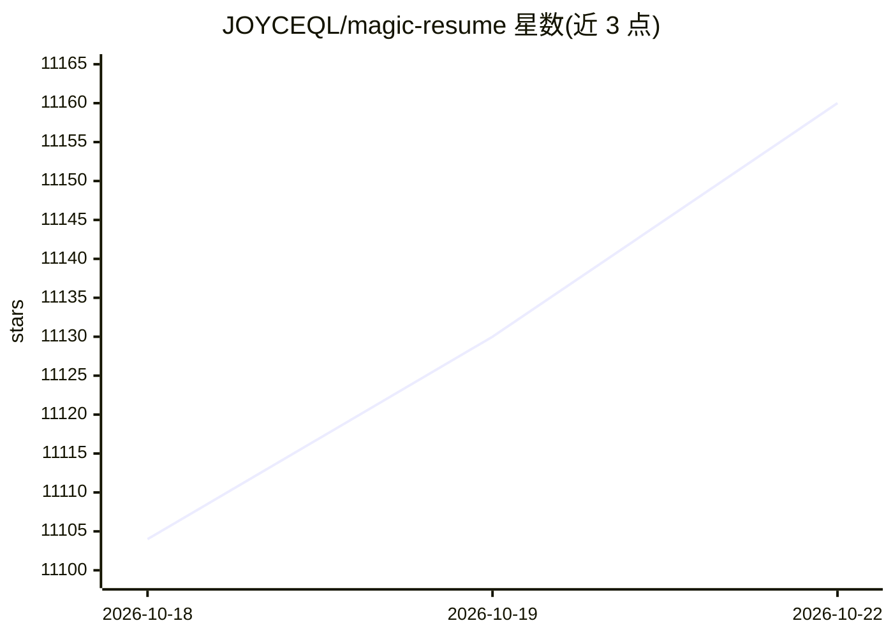

# JOYCEQL/magic-resume

⭐ 11,160 · TypeScript · NOASSERTION · 推送 2026-10-19 · [GitHub](https://github.com/JOYCEQL/magic-resume) · [官网](https://magicv.art) · 个人维护 · 中文 README

**在线 AI 辅助简历编辑器，支持实时预览与多格式导出**

基于 TanStack Start、TypeScript 与 Framer Motion 构建的在线简历编辑器：实时预览、自定义主题、暗色模式、自动保存与本地存储，支持导出 PDF 及导入 PDF/Markdown，AI 部分为辅助写作，可配置 DeepSeek、Qwen、Doubao 等模型（直连），其他模型（OpenAI/Gemini/Anthropic）经 Cloudflare Workers 或代理接入。部署方式含 pnpm 源码运行与 Docker Compose；源码 Apache 2.0 附加非商业使用限制。

## 筛选速览

| 维度 | 判定 | 备注 |
|---|---|---|
| AI 角色 | `ai-enhanced` | 去掉 AI 部分产品仍成立 |
| 许可风险 | `none` | NOASSERTION |
| 部署形态 | `self-host` | docker 或自建部署 |
| 模型依赖 | — | README 未给出锁定关系 |
| 硬件要求 | — | 无带数字的原话,不猜 |
| 安装摩擦 | `low` | 无编译、无系统依赖或容器化 |
| 成熟度 | — | 结构信号不足 |

## 能力要点

- AI 辅助写作，支持 DeepSeek/Qwen/Doubao 直连与自定义模型
- 实时预览、自定义主题、暗色模式、自动保存
- 导出 PDF，导入 PDF/Markdown，自动一页排版
- 提供 Docker Compose 部署

## 适用场景

- 在线编辑并导出个人简历
- 用 AI 辅助润色简历内容
- 自部署一套简历编辑服务供个人使用

## 场景标签

`AI 写作` · 领域:内容生成

## 证据(README 行号)

> L11: Magic Resume is a modern online resume editor that makes creating professional resumes simple and enjoyable. Built 
> L107: - [x] AI-assisted writing

## 星数曲线

2026-10-18 11,104 → 2026-10-22 11,160（+56）

---
*卡片 v1 · prompt 1.4 · 生成 2026-10-20 · 置信度 mid · 依据 README sha `5f5b4dbf7e9b` · [字段定义](../../DATASET.md)*
