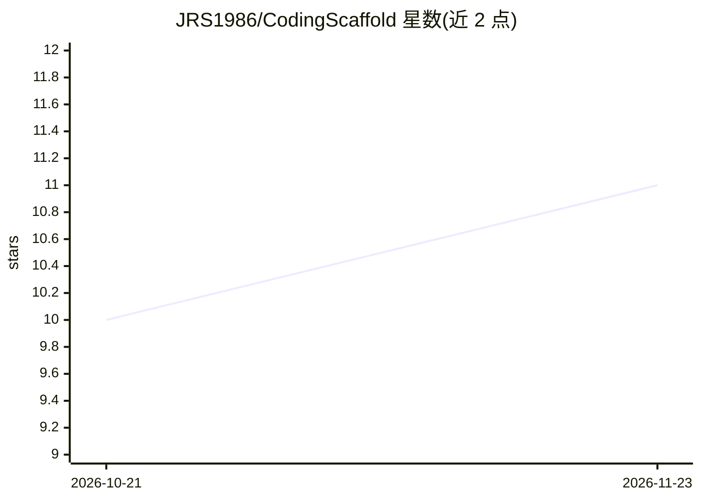

# JRS1986/CodingScaffold

⭐ 11 · Python · Apache-2.0 · 推送 2026-09-19 · [GitHub](https://github.com/JRS1986/CodingScaffold) · 个人维护

**为 AI 编码代理准备项目上下文与治理脚手架的 CLI 工具**

面向 AI 辅助开发团队的本地优先引导与治理层：通过 setup/doctor/pilot/eval/session 等命令为现有编码代理生成项目本地文件，包括规则、凭据模板、工具适配器、模型选择建议、团队知识库与新人上手清单。启动与检测均为本地 Python 工作流，不发送提示词到模型；LLM 仅在代理实际运行时经 Ollama、OpenAI、Anthropic 等路径调用。不绑定单一模型、提供商或编码工具，自身不是编码代理。

## 筛选速览

| 维度 | 判定 | 备注 |
|---|---|---|
| AI 角色 | `ai-ecosystem` | LLM/agent 周边工具 |
| 许可风险 | `permissive` | Apache-2.0 |
| 部署形态 | `library` | 以包/库形式分发 |
| 模型依赖 | local-ok | 支持本地模型 |
| 硬件要求 | — | 无带数字的原话,不猜 |
| 安装摩擦 | `low` | 无编译、无系统依赖或容器化 |
| 成熟度 | — | 结构信号不足 |

## 能力要点

- 按语言、项目形态、隐私偏好与硬件/提供商信号自适应生成脚手架文件
- bootstrap 阶段无需 LLM：select-model 用确定性分类器推荐路由
- 会话轨迹、决策、提示词可捕获为 Markdown 并经 Git 晋升为团队知识库
- doctor/pilot 只做只读检查并打印建议命令，不静默安装

## 适用场景

- 新仓库接入编码代理前生成规则与项目上下文
- 团队成员在不同项目中复用一致的代理工作流
- 把个人会话中的经验沉淀为可审阅的团队知识库
- 给新加入的开发者提供代理使用的 onboarding 清单

## 场景标签

`知识库管理` · 领域:知识与检索

## 证据(README 行号)

> L83: CodingScaffold is the bootstrap and governance layer that makes existing coding agents usable,
> L92: by itself, and not a universal model router. Runtime routing is optional; the core product is the
> L97: CodingScaffold does not need an LLM to start. Guided setup, hardware probe, provider detection,

## 星数曲线

2026-10-21 10 → 2026-11-23 11（+1）

---
*卡片 v1 · prompt 1.4 · 生成 2026-11-20 · 置信度 high · 依据 README sha `f4131c4576bb` · [字段定义](../../DATASET.md)*
