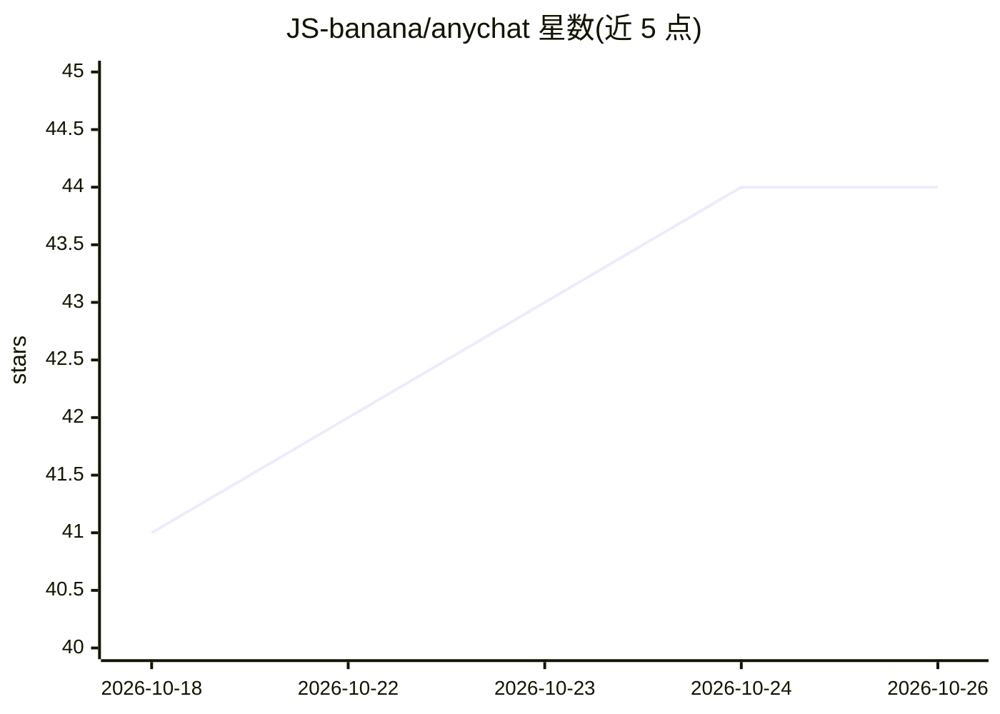

# JS-banana/anychat

⭐ 44 · TypeScript · MIT · 推送 2026-04-27 · [GitHub](https://github.com/JS-banana/anychat) · 个人维护 · 中文 README

**多 AI 聊天服务聚合的桌面客户端，统一入口切换使用**

基于 Tauri 2.0、React 19 与 Rust 构建的桌面应用，在一个窗口内聚合管理 ChatGPT、Gemini、Claude 等 12 种以上 AI 聊天服务，支持快捷键快速切换。定位为统一入口与低占用的桌面端体验，安装包大小为 7 MB，面向 macOS 平台。README 另提示 Mac 打开时如提示已损坏需执行 xattr 命令移除隔离属性。

## 筛选速览

| 维度 | 判定 | 备注 |
|---|---|---|
| AI 角色 | `ai-ecosystem` | LLM/agent 周边工具 |
| 许可风险 | `permissive` | MIT |
| 部署形态 | `None` |  |
| 模型依赖 | — | README 未给出锁定关系 |
| 硬件要求 | — | 无带数字的原话,不猜 |
| 安装摩擦 | `low` | 无编译、无系统依赖或容器化 |
| 成熟度 | — | 结构信号不足 |

## 能力要点

- 聚合 ChatGPT、Gemini、Claude 等 12+ 种 AI 服务
- 基于 Tauri，安装包大小 7 MB
- 快捷键快速切换服务

## 适用场景

- 在一个桌面窗口中使用多个 AI 聊天服务
- 用快捷键在多个 AI 服务间快速切换
- 寻找低占用的桌面端 AI 聊天入口

## 场景标签

`聊天机器人` · 领域:对话与助手

## 证据(README 行号)

> L13: AnyChat 是一个聚合了多个 AI 聊天服务的桌面应用，旨在提供统一入口与低占用的桌面端体验。它让你能在一个窗口中无缝切换不同的 AI 服务，专注于高性能、轻量化的日常使用。
> L25: - **🚀 多服务聚合**: 统一管理 ChatGPT, Gemini, Claude 等 12+ 种主流 AI 服务。

## 星数曲线

2026-10-18 41 → 2026-10-26 44（+3）

---
*卡片 v1 · prompt 1.4 · 生成 2026-10-25 · 置信度 high · 依据 README sha `bea36dde3431` · [字段定义](../../DATASET.md)*
