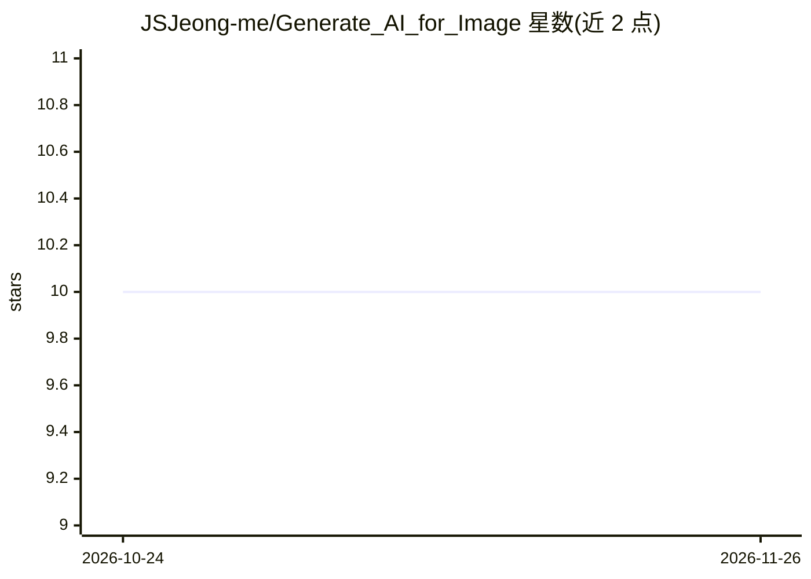

# JSJeong-me/Generate_AI_for_Image

⭐ 10 · Jupyter Notebook · MIT · 推送 2026-09-11 · [GitHub](https://github.com/JSJeong-me/Generate_AI_for_Image) · 个人维护

**面向学习者的 Stable Diffusion 图像生成课程讲义与实录**

韩国互联网信息学会2024年春季学术大会配套的生成式 AI 图像生成课程资料库：两日课程大纲覆盖扩散模型原理、Stable Diffusion Web UI 使用、模型选择与提示词编写、LoRA/VAE/ControlNet 风格控制、LoRA 模型训练、txt2img 参数、向量相似度评估与图像 Captioning。仓库提供论文、发表资料、讲课与实讲教案（Google Drive/Docs 链接）及实讲 Prompts，本身不含可安装代码。

## 筛选速览

| 维度 | 判定 | 备注 |
|---|---|---|
| AI 角色 | `ai-knowledge` | 知识聚合/清单类 |
| 许可风险 | `permissive` | MIT |
| 部署形态 | `None` |  |
| 模型依赖 | — | README 未给出锁定关系 |
| 硬件要求 | — | 无带数字的原话,不猜 |
| 安装摩擦 | `low` | 无编译、无系统依赖或容器化 |
| 成熟度 | — | 结构信号不足 |

## 能力要点

- 两日课程大纲：从扩散模型原理到 LoRA 训练与图像 Captioning
- 提供讲课教案与实讲教案的外部文档链接
- 收录 2024 年韩国互联网信息学会春季学术大会发表资料
- 附实讲 Prompts 与 Top 50 GenAI Web Products 议题分析

## 适用场景

- 想系统学习 Stable Diffusion 图像生成流程
- 想动手训练自己的 LoRA 模型
- 为图像生成课程准备教学材料

## 场景标签

`教程课程` `图像生成` · 领域:内容生成

## 证据(README 行号)

> L4: - [[강의 교안]](https://drive.google.com/file/d/1JcWilbrTttvsp_D4BFFyGTx-6b7GQsjz/view?usp=sharing)
> L49: ### 2일차 강의 내용

## 星数曲线

2026-10-24 10 → 2026-11-26 10（+0）

---
*卡片 v1 · prompt 1.4 · 生成 2026-11-20 · 置信度 high · 依据 README sha `7cc7a457e6f8` · [字段定义](../../DATASET.md)*
