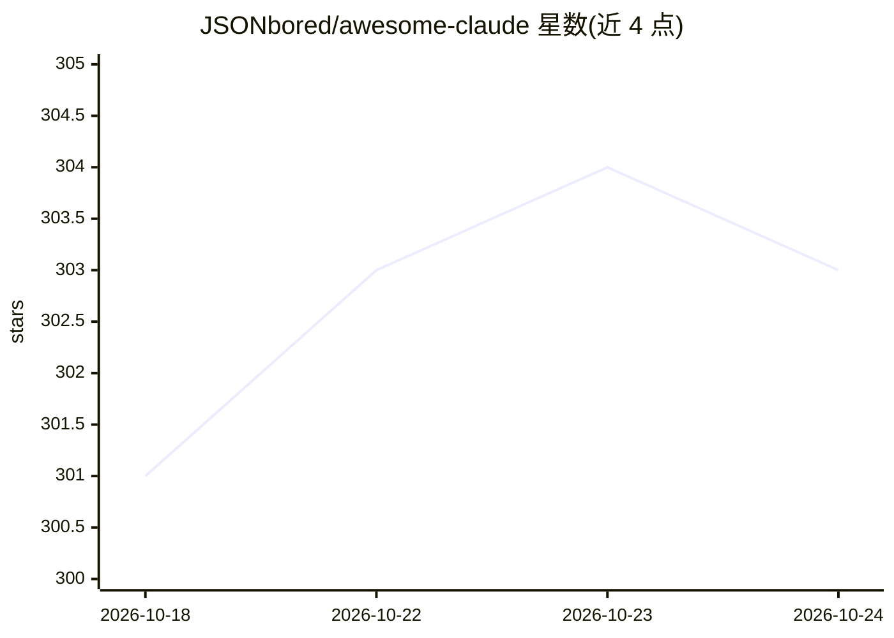

# JSONbored/awesome-claude

⭐ 304 · MDX · MIT · 推送 2026-08-16 · [GitHub](https://github.com/JSONbored/awesome-claude) · [官网](https://heyclau.de) · 个人维护

**Claude 生态资源人工审编目录：1388+ 条 agent/技能/MCP 条目**

面向 Claude 生态建设者与使用者的策展注册表：以文件与源仓库为背书，人工审编收录 agents、MCP servers、skills、hooks、commands、rules、guides 等共 1388+ 条目，分 10 个板块组织。条目经 PR 优先、内容校验与 Superagent/维护者 agent 审核后合并，不接受社区 ZIP 包上传。注册表可通过 JSON/RSS/Atom/LLM 文本导出、Raycast 数据与只读 MCP server 形式被程序化消费，本地内容校验与构建使用 pnpm 命令。

## 筛选速览

| 维度 | 判定 | 备注 |
|---|---|---|
| AI 角色 | `ai-knowledge` | 知识聚合/清单类 |
| 许可风险 | `permissive` | MIT |
| 部署形态 | `library` | 以包/库形式分发 |
| 模型依赖 | locked-api |  |
| 硬件要求 | — | 无带数字的原话,不猜 |
| 安装摩擦 | `low` | 无编译、无系统依赖或容器化 |
| 成熟度 | — | 结构信号不足 |

## 能力要点

- 1388+ 文件背书条目，10 个板块（Agents/MCP Servers/Skills/Rules 等）
- AI 审核合并门禁：内容校验 + Superagent + 私有维护者 agent 审查
- 注册表以 JSON/RSS/Atom/LLM 导出、Raycast 数据与只读 MCP server 分发
- PR 优先投稿流程，附 pnpm 本地校验与构建命令

## 适用场景

- 查找 Claude agent、MCP server、技能等生态资源
- 通过 MCP 或 JSON feed 将资源目录接入自己的工具链
- 向社区提交自有 Claude 资源条目

## 场景标签

`精选清单` · 领域:学习与行业

## 证据(README 行号)

> L5:  HeyClaude is a file-backed, human-reviewed directory for Claude agents,
> L9:  1388+ file-backed entries stay useful as both an
> L28:  1388 entries

## 星数曲线

2026-10-18 301 → 2026-10-24 303（+2）

---
*卡片 v1 · prompt 1.4 · 生成 2026-10-21 · 置信度 mid · 依据 README sha `1df7dad1dc59` · [字段定义](../../DATASET.md)*
