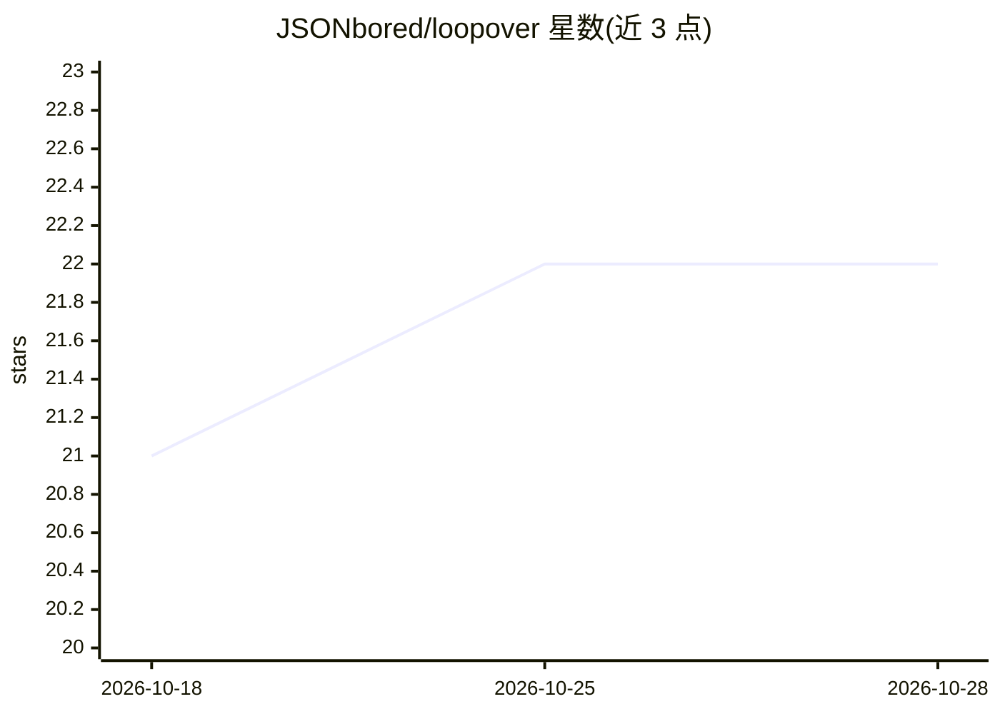

# JSONbored/loopover

⭐ 22 · TypeScript · AGPL-3.0 · 推送 2026-10-11 · [GitHub](https://github.com/JSONbored/loopover) · [官网](https://loopover.ai) · 组织维护

**自主代码评审与开发循环代理：自动评审、合并 GitHub PR**

面向 GitHub 仓库维护者与贡献者的自主开发循环系统：自托管的评审代理端到端处理 PR 队列，基于 CI 状态、变更后文件全文与代码库 RAG 进行 AI 评审，可自行门控、批准、要求修改、合并或关闭，并受 dry-run/pause/freeze/kill-switch 控制。贡献者可通过 @loopover/mcp 将门控预测、分支预检等能力接入自己的 AI 客户端；另有面向 Bittensor SN74 矿工的自主运行时。合并/关闭决策附带公开的精度报告与可回放回测语料；托管版本尚在开发中，当前仅支持自托管。

## 筛选速览

| 维度 | 判定 | 备注 |
|---|---|---|
| AI 角色 | `ai-ecosystem` | LLM/agent 周边工具 |
| 许可风险 | `viral` | AGPL-3.0 |
| 部署形态 | `library` | 以包/库形式分发 |
| 模型依赖 | — | README 未给出锁定关系 |
| 硬件要求 | — | 无带数字的原话,不猜 |
| 安装摩擦 | `low` | 无编译、无系统依赖或容器化 |
| 成熟度 | `idea` | |

## 能力要点

- AI 评审以 CI 状态、变更后全文与代码库 RAG 为依据
- 合并/关闭决策结果确认并发布带置信区间的公平性报告
- dry-run/pause/freeze/kill-switch 安全控制
- @loopover/mcp 可接入 codex/claude/cursor 等客户端

## 适用场景

- 维护者用自主代理处理 PR 评审与合并队列
- 在自己的 AI 客户端中获得门控预测与分支预检
- Bittensor SN74 矿工跨仓库无人值守运行

## 场景标签

`代码审查` `编码 Agent` · 领域:编码与开发

## 证据(README 行号)

> L16: - **For maintainers (self-hosted):** an autonomous review agent works the PR queue end-to-end — AI review grounded 
> L17: - **For contributors:** the `@loopover/mcp` copilot brings predicted gate verdicts, branch preflight, duplicate det

## 星数曲线

2026-10-18 21 → 2026-10-28 22（+1）

---
*卡片 v1 · prompt 1.4 · 生成 2026-10-27 · 置信度 high · 依据 README sha `e7d655e05e28` · [字段定义](../../DATASET.md)*
