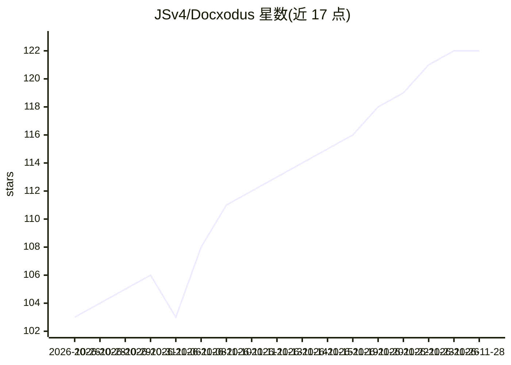

# JSv4/Docxodus

⭐ 122 · C# · MIT · 推送 2026-11-27 · [GitHub](https://github.com/JSv4/Docxodus) · [官网](https://jsv4.github.io/Docxodus/) · 个人维护

**面向开发者与 agent 的 .docx 多形态工具包：渲染、编辑、比对**

基于结构感知 OOXML 引擎的 .docx 处理工具集，提供 DOCX→HTML 保真渲染、浏览器内块编辑器、生成 Word 原生 tracked-changes 的文档比对，以及带稳定锚点 id 的 markdown 投影供 agent 定位编辑。同一引擎以 .NET 库、浏览器 WASM 模块、npm/TypeScript 包、Python 客户端、MCP server 和三个 CLI 工具分发。npm 包内嵌 WASM，无需安装 .NET 或运行服务端；旧 WmlComparer 引擎已在 v11.0.0 移除。

## 筛选速览

| 维度 | 判定 | 备注 |
|---|---|---|
| AI 角色 | `ai-enhanced` | 去掉 AI 部分产品仍成立 |
| 许可风险 | `permissive` | MIT |
| 部署形态 | `library` | 以包/库形式分发 |
| 模型依赖 | — | README 未给出锁定关系 |
| 硬件要求 | — | 无带数字的原话,不猜 |
| 安装摩擦 | `medium` | 含编译或系统依赖之一 |
| 成熟度 | — | 结构信号不足 |

## 能力要点

- 结构比对生成 Word 原生 w:ins/w:del 等修订标记，可被 Word 打开接受/拒绝
- markdown 投影中每个块携带内容派生的稳定锚点 id，跨渲染、diff、编辑目标共享
- MCP server 提供 23 个 stdio 工具（open/search/edit/compare/save 等），本地运行且安装后无网络调用
- 浏览器编辑器只重渲染变更块，save() 返回无损字节

## 适用场景

- 将合同类 .docx 渲染为浏览器中可翻页预览的 HTML
- 对两份 Word 文档做可交付给律师的红线比对
- 让 LLM agent 通过锚点 id 定位并改写文档条款后无损保存
- 将文档导出为带 token 位置的 OpenContracts 格式供 NLP 流程使用

## 场景标签

`文档解析` · 领域:知识与检索

## 证据(README 行号)

> L13: A `.docx` is a zip full of XML that only one program really understands. Docxodus is the toolkit that
> L20: a **Python client**, an **MCP server for AI agents**, and three **CLI tools** — all over the same
> L173: |Call tools over the Model Context Protocol|`Docxodus.McpServer` — 23 tools over stdio: open, search, edit, format

## 星数曲线

2026-10-26 103 → 2026-11-28 122（+19）

---
*卡片 v1 · prompt 1.4 · 生成 2026-11-28 · 置信度 high · 依据 README sha `60b4d86e0eb6` · [字段定义](../../DATASET.md)*
