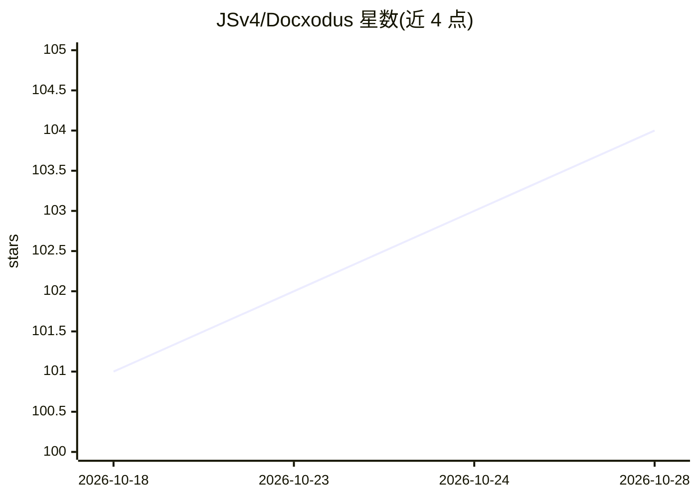

# JSv4/Docxodus

⭐ 104 · C# · MIT · 推送 2026-10-27 · [GitHub](https://github.com/JSv4/Docxodus) · [官网](https://jsv4.github.io/Docxodus/) · 个人维护

**面向 LLM agent 的 DOCX 工具箱：渲染/编辑/对比/锚定 markdown 投影**

结构感知的 OOXML 引擎，提供 DOCX→HTML 高保真渲染（含分页/脚注/批注）、带稳定锚点的 markdown 投影、有状态编辑会话（DocxSession）、生成 Word 原生修订标记（w:ins/w:del）的结构化对比，以及浏览器端块编辑器（WASM、无服务器）。同一引擎封装为 .NET 库、npm 包、Python 客户端（Beta，标注为 agent 长驻会话设计）与三个 CLI 工具。锚点跨投影/渲染 DOM/差异/编辑目标共用，供 agent 定点读写文档。

## 筛选速览

| 维度 | 判定 | 备注 |
|---|---|---|
| AI 角色 | `ai-ecosystem` | LLM/agent 周边工具 |
| 许可风险 | `permissive` | MIT |
| 部署形态 | `library` | 以包/库形式分发 |
| 模型依赖 | — | README 未给出锁定关系 |
| 硬件要求 | — | 无带数字的原话,不猜 |
| 安装摩擦 | `medium` | 含编译或系统依赖之一 |
| 成熟度 | `idea` | |

## 能力要点

- DOCX→HTML 高保真渲染（分页模式、脚注、批注、页眉页脚）
- 每块带内容派生稳定锚点的 markdown 投影，跨层共享同一寻址系统
- 对比输出 Word 原生修订标记，accept/reject 往返契约可验证
- DocxSession 有状态编辑会话 + 浏览器端 WASM 编辑器

## 适用场景

- 让 LLM agent 通过锚点定点读写法律/合同文档并写回 DOCX
- 生成对方律师可直接在 Word 中接受/拒绝的修订红线
- 在浏览器内无服务器编辑 DOCX 并无损保存
- 构建文档审阅/审批工作流（修订即数据、JSON 编辑脚本）

## 场景标签

`文档解析` · 领域:知识与检索

## 证据(README 行号)

> L109: `WmlToMarkdownConverter` renders a document as markdown where **every block carries a stable id**.
> L117: - Read the markdown, decide "rewrite the indemnification clause", write back to that anchor.
> L4:  Render them, edit them, diff them, and hand them to an agent — from .NET, the browser, Python, or the shell.

## 星数曲线

2026-10-18 101 → 2026-10-28 104（+3）

---
*卡片 v1 · prompt 1.4 · 生成 2026-10-23 · 置信度 high · 依据 README sha `7b72222fd554` · [字段定义](../../DATASET.md)*
