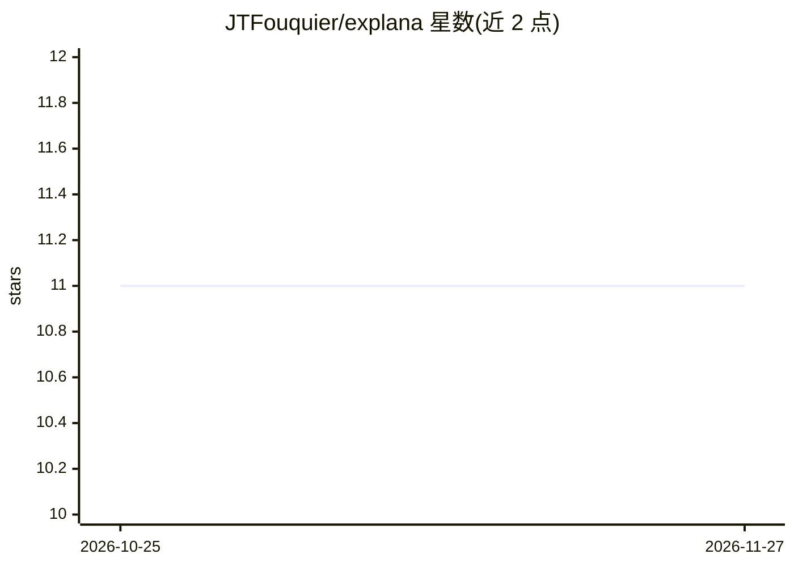

# JTFouquier/explana

⭐ 11 · Python · NOASSERTION · 推送 2026-04-03 · [GitHub](https://github.com/JTFouquier/explana) · [官网](https://www.expana.io) · 个人维护

**面向微生物组纵向/横断面研究的特征筛选工作流**

EXPLANA 是一个基于 Snakemake 的探索性分析与特征选择工作流，用于在横断面和纵向微生物组研究中识别与结局变量相关的关键特征，也适用于其他类型数据。结局变量支持数值或二元分类，特征支持数值与分类型，并提供检测分类顺序随时间影响响应的功能。特征按重要性排序并给出对响应的影响，生成可交互的 .html 报告。以源码形式安装，需通过 Mamba 创建 conda 环境并用 Snakemake 运行；许可仅限学术与非商业用途，商业使用需另行授权。

## 筛选速览

| 维度 | 判定 | 备注 |
|---|---|---|
| AI 角色 | `ai-native` | 本体是模型或模型工具 |
| 许可风险 | `none` | NOASSERTION |
| 部署形态 | `None` |  |
| 模型依赖 | — | README 未给出锁定关系 |
| 硬件要求 | — | 无带数字的原话,不猜 |
| 安装摩擦 | `low` | 无编译、无系统依赖或容器化 |
| 成熟度 | — | 结构信号不足 |

## 能力要点

- 按特征重要性排序并提供特征对响应的影响
- 生成可交互的 .html 可视化报告
- 支持纵向研究中分类顺序对响应影响的检测
- 经同行评审发表于 Bioinformatics

## 适用场景

- 微生物组研究中筛选与结局相关的关键特征
- 纵向研究中探索分类特征随时间的影响
- 生成可分享的交互式探索性分析报告

## 场景标签

`数据分析` `工作流自动化` `科研工具` · 领域:效率与自动化

## 证据(README 行号)

> L3: EXPLANA: A user-friendly workflow for EXPLoratory ANAlysis and feature selection in cross-sectional and longitudinal
> L8: EXPLANA was developed to streamline identification of key features that relate to outcomes of interest in cross-sect
> L12: Features are ranked by their importance, and feature impact on response is provided. An interactive .html report is

## 星数曲线

2026-10-25 11 → 2026-11-27 11（+0）

---
*卡片 v1 · prompt 1.4 · 生成 2026-11-19 · 置信度 high · 依据 README sha `c13030ce8a14` · [字段定义](../../DATASET.md)*
