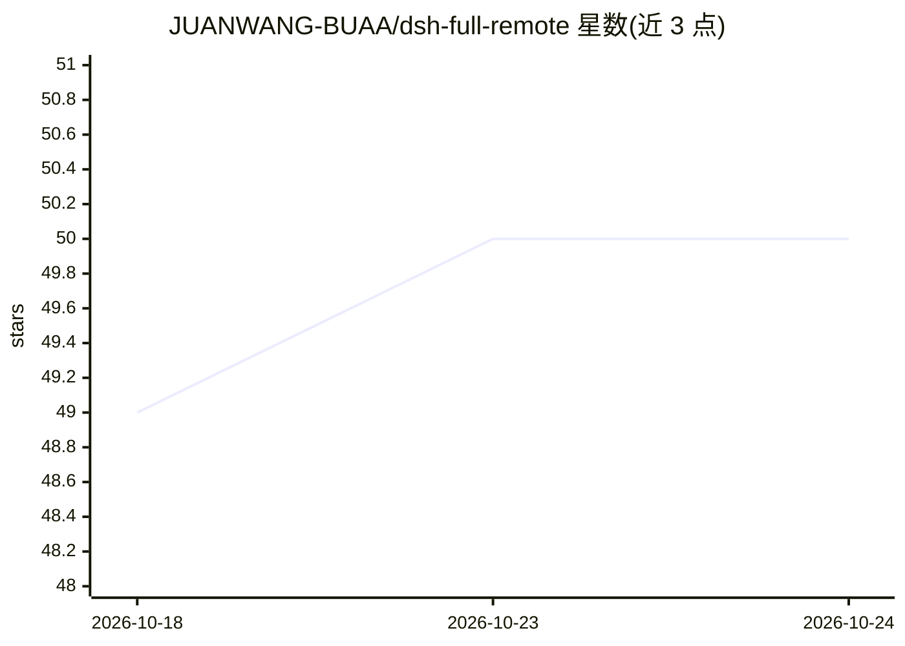

# JUANWANG-BUAA/dsh-full-remote

⭐ 51 · TypeScript · MIT · 推送 2026-10-22 · [GitHub](https://github.com/JUANWANG-BUAA/dsh-full-remote) · [官网](https://www.npmjs.com/package/dsh-full-remote) · 个人维护 · 中文 README

**DeepSeek Harness 插件：带令牌认证的反向代理，实现远程/移动访问**

面向 DeepSeek Harness 用户的 Node.js 插件：在 Harness Web 服务器前放置认证反向代理，改写 Host/Origin 头使 settings、credentials、目录浏览等特权 API 在公网隧道或局域网下可用。提供 192 位访问令牌、按设备独立会话、一次性 QR 邀请、JSONL 审计日志、CIDR 白名单与失败锁定，可从面板一键启动 Cloudflare quick tunnel，也兼容 cloudflared/ngrok/frp/SSH/Tailscale。附手机端 Task cockpit 处理审批与问答。快速隧道定位为临时分享而非生产部署。

## 筛选速览

| 维度 | 判定 | 备注 |
|---|---|---|
| AI 角色 | `ai-ecosystem` | LLM/agent 周边工具 |
| 许可风险 | `permissive` | MIT |
| 部署形态 | `library` | 以包/库形式分发 |
| 模型依赖 | locked-api |  |
| 硬件要求 | — | 无带数字的原话,不猜 |
| 安装摩擦 | `low` | 无编译、无系统依赖或容器化 |
| 成熟度 | — | 结构信号不足 |

## 能力要点

- Host/Origin 改写使特权 API 通过隧道可用，并以自有访问控制层替代原信任检查
- 192 位令牌、按设备会话、一次性 QR 邀请、CIDR 白名单与逐 IP 锁定
- 结构化 JSONL 审计日志（登录/审批/吊销/轮换等），面板内查看与导出
- 面板一键启动 Cloudflare quick tunnel 并生成二维码，支持 Brotli/gzip 压缩与静态缓存

## 适用场景

- 在手机上通过公网隧道访问家用服务器上的 DeepSeek Harness 并保留特权 API
- 为远程设备发放可吊销的独立会话并审计访问
- 临时无公网 IP 场景下用 Cloudflare quick tunnel 分享访问

## 场景标签

 · 领域:LLM 工具链/远程访问

## 证据(README 行号)

> L19: `dsh-full-remote` is a plugin for
> L21: places an authenticated reverse proxy in front of the Harness Web server,
> L99: The plugin inserts a reverse proxy between the tunnel and the Harness Web

## 星数曲线

2026-10-18 49 → 2026-10-24 50（+1）

---
*卡片 v1 · prompt 1.4 · 生成 2026-10-24 · 置信度 mid · 依据 README sha `cc8e8d90cc97` · [字段定义](../../DATASET.md)*
